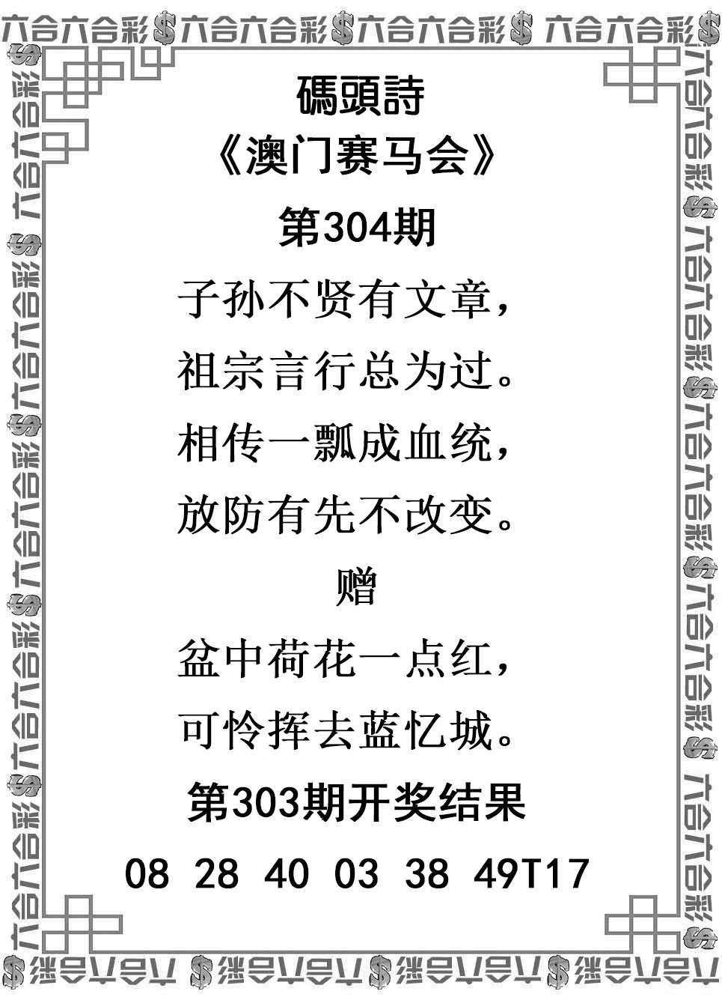
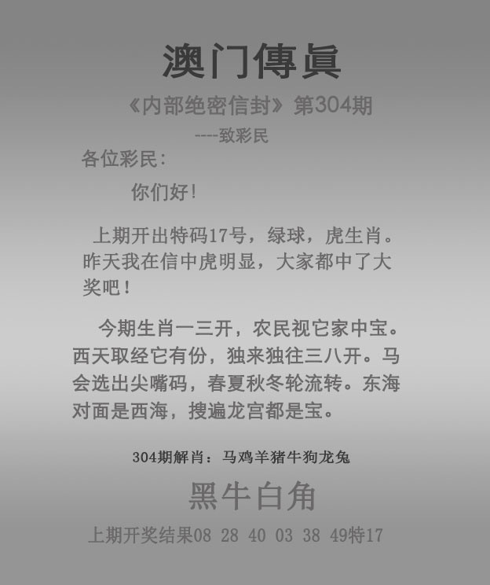
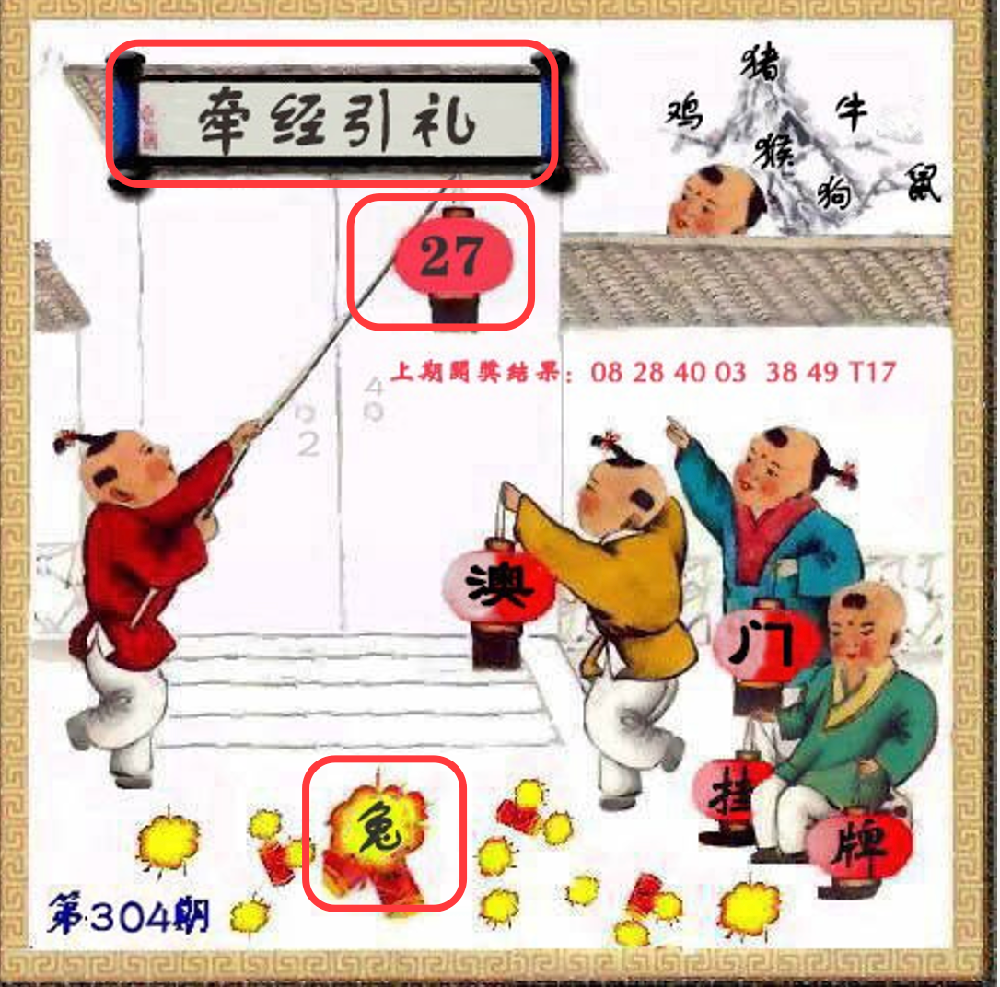

# 2026年第304期

- [资料说明](资料说明.md)
- [原分析归档整理](分析-v001.md)
- [用户纠偏](分析-v002.md)
- [预测版本记录](预测记录.json)
- [开奖结果](开奖结果.md)
- [复盘](复盘.md)
- [归档元数据](归档信息.json)

## 原图预览

### 01-管家婆

### 02-跑马

### 03-跑狗

### 04-码头诗

### 05-澳门传真

### 06-澳门挂牌

## 最新挂牌范围修正

用户确认仅分析牵经引礼，27龙及爆兔只作可由强交叉覆盖的降权；其他画面忽略。详见[纠偏v003](分析-v003.md)。

- [非标准谜面纠偏v004](分析-v004.md)

## 当前完整分析

[查看v005完整重分析及新排序](分析-v005.md)。主六肖：牛、兔、龙、鼠、马、猴；防三肖：猪、蛇、鸡。旧版本保留，待用户提供开奖结果。
