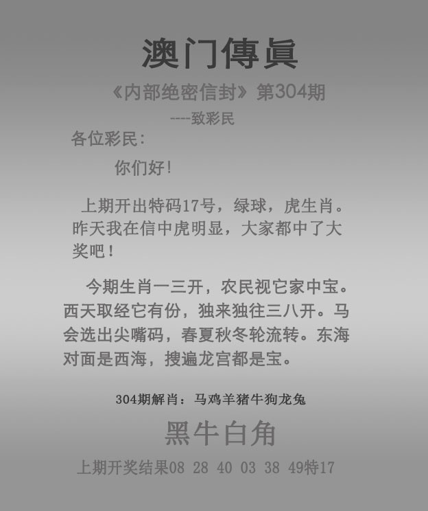
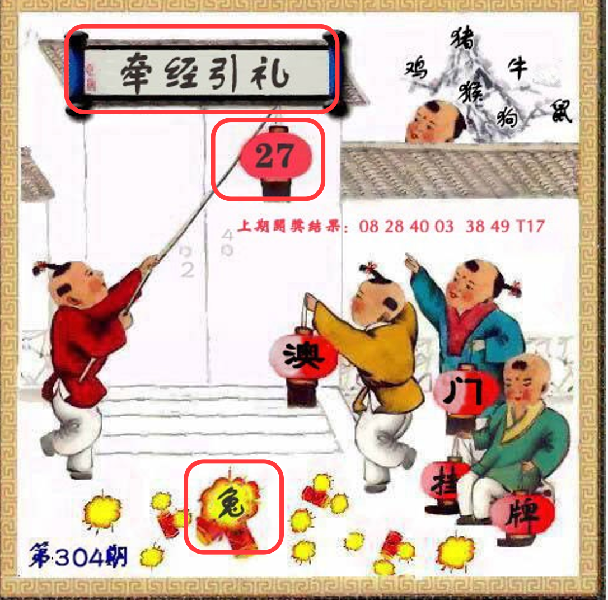

# 2026年第304期资料

接收日期：2026-10-31。来源：本项目对话用户附件，共6张原图；图注304期10月31日。原件见原始资料目录，哈希见归档信息.json。

| 原图 | 有效范围与文字摘要 |
| --- | --- |
| [管家婆](原始资料/01-管家婆.jpg) | 月明南北两瑶台；排除平特玄机及上期回放 |
| [跑马](原始资料/02-跑马.jpg) | 一钱如命；兔起鹘落；横风斜雨摇衰柳，昔时王者皆通四；紫葡垂架、藤蔓缠竿，青藤绕架挂明珠；蜗牛缓行、园间生趣，紫穗垂垂映画图；看、阶，总6划 |
| [跑狗](原始资料/03-跑狗.jpg) | 涉笔成趣；兔起鹘落；栖石寻果、鸟语花香；独倚枝头寻果子；远山如黛、春临凡尘；万贯身家上天定；香、临，总9划；虎冲猴 |
| [码头诗](原始资料/04-码头诗.jpg) | 子孙不贤有文章；祖宗言行总为过；相传一瓢成血统；放防有先不改变；赠：盆中荷花一点红，可怜挥去蓝忆城。部分句意不通，保留识读疑问 |
| [澳门传真](原始资料/05-澳门传真.jpg) | 今期生肖一三开，农民视它家中宝；西天取经它有份，独来独往三八开；马会选出尖嘴码，春夏秋冬轮流转；东海对面是西海，搜遍龙宫都是宝；黑牛白角。无红框，原分析以正文及四字为范围假定 |
| [挂牌](原始资料/06-澳门挂牌.jpg) | 挂27、爆字位置见兔；上方四字原分析读作牵经引礼，尚待确认；右上六小忽略 |

图中上期303结果为08、28、40、03、38、49，特17，仅作图片转录，未独立联网核验，不是304期开奖结果。暗码、解九肖按用户最新纠正完全忽略。

## 原始图片预览

以下展示用户提供的6张原始图片，点击图片名称可查看原件。

### 01-管家婆

[01-管家婆](原始资料/01-管家婆.jpg)

### 02-跑马

[02-跑马](原始资料/02-跑马.jpg)

### 03-跑狗

[03-跑狗](原始资料/03-跑狗.jpg)

### 04-码头诗

[04-码头诗](原始资料/04-码头诗.jpg)

### 05-澳门传真

[05-澳门传真](原始资料/05-澳门传真.jpg)

### 06-澳门挂牌

[06-澳门挂牌](原始资料/06-澳门挂牌.jpg)

## 最新挂牌范围修正

用户确认仅分析牵经引礼，27龙及爆兔只作可由强交叉覆盖的降权；其他画面忽略。详见[纠偏v003](分析-v003.md)。

