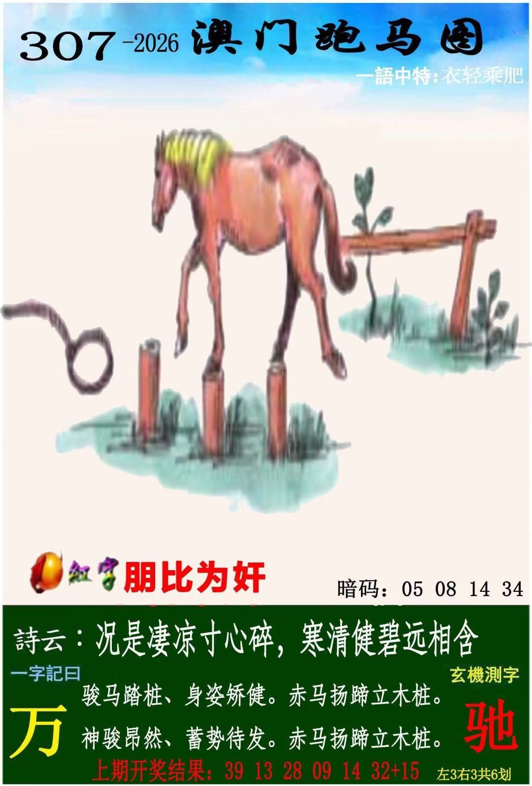
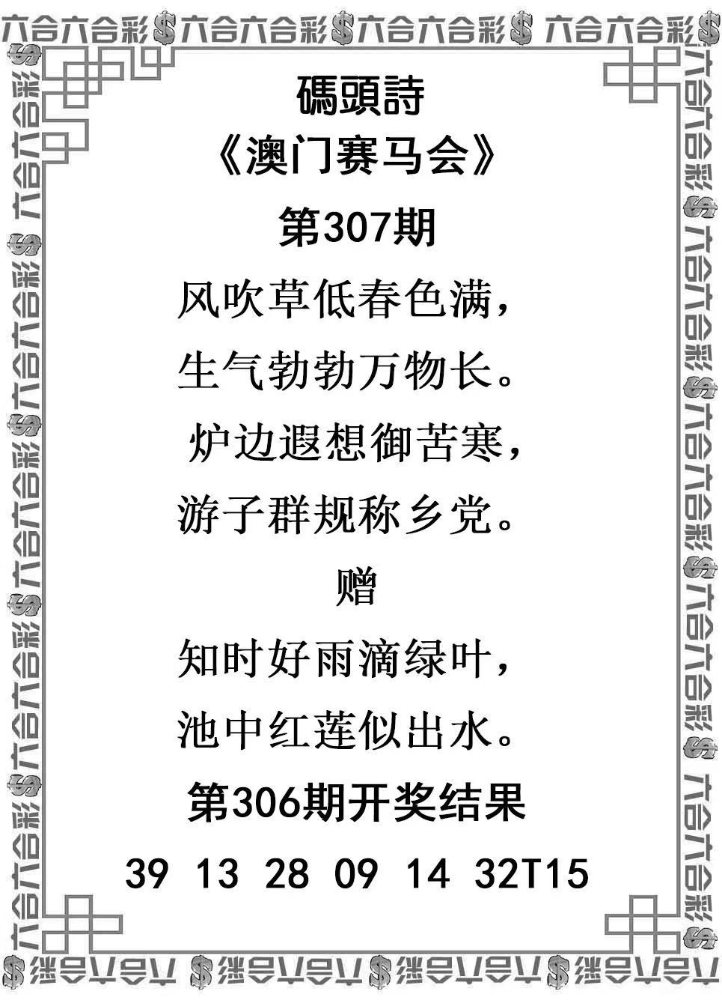
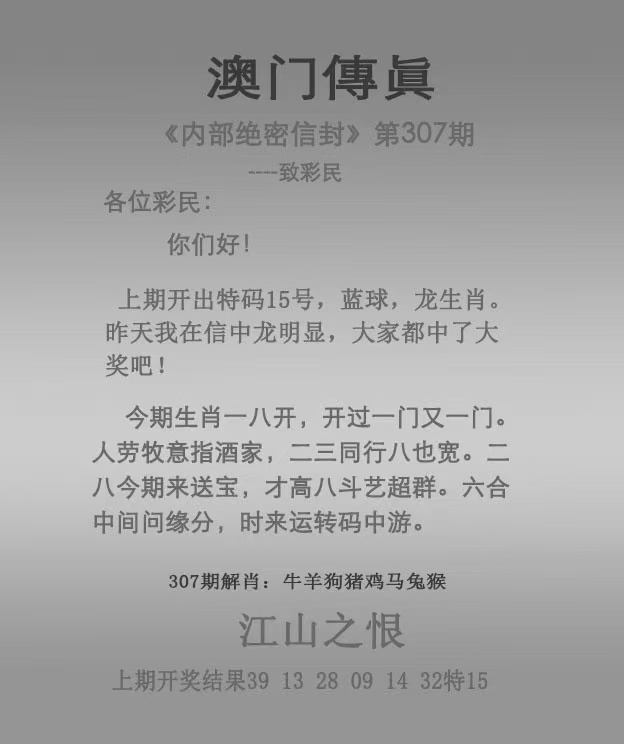

# 2026年第307期

[完整分析v001](分析-v001.md) · [资料说明](资料说明.md) · [预测记录](预测记录.json) · [证据表](证据表.csv)

主马羊牛鼠兔狗；防猴蛇龙。完整暂定，保留疑字，未锁单号。

### 管家婆

### 跑马

### 跑狗

### 码头诗

### 澳门传真

### 澳门挂牌

[用户纠正v002：未中特不削弱有效交叉](分析-v002.md)。历史未中特不作本期降权依据，沿用v001主防。
