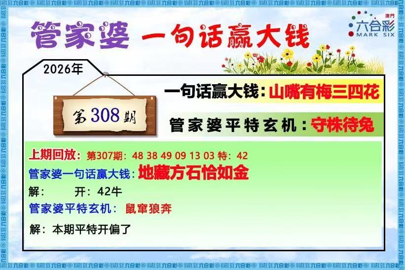
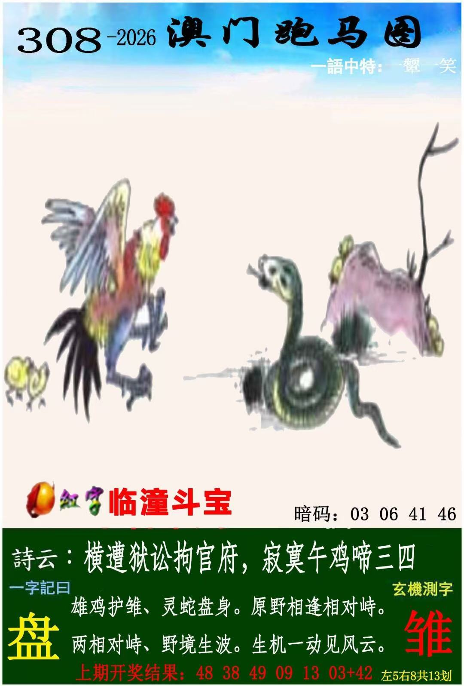
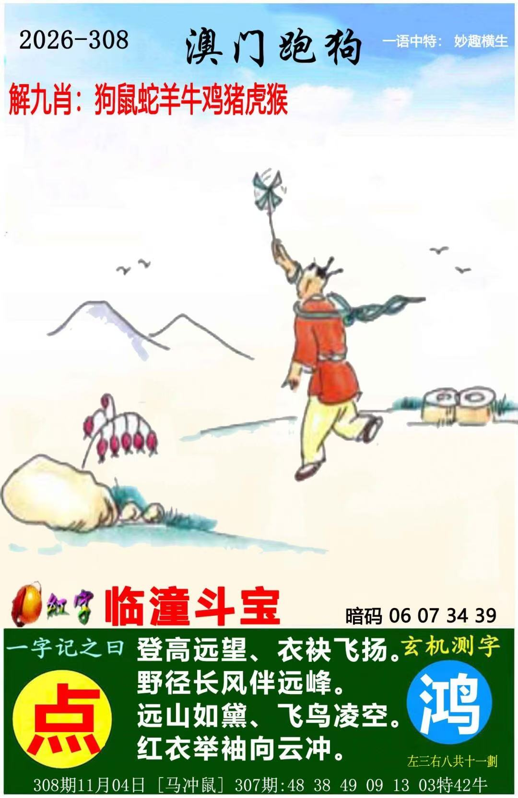
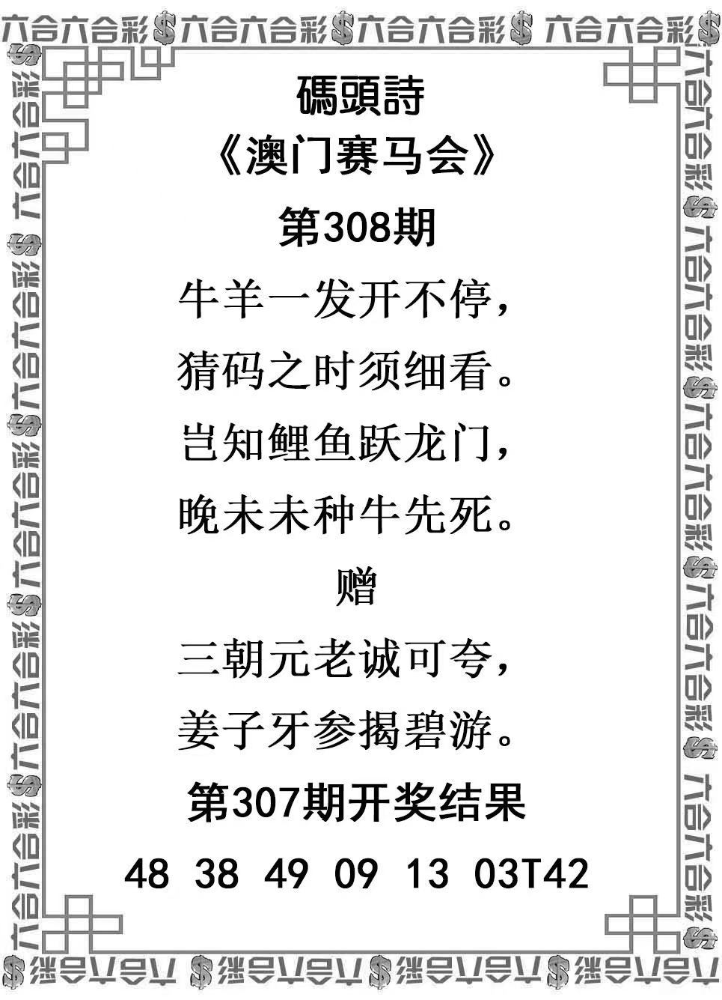
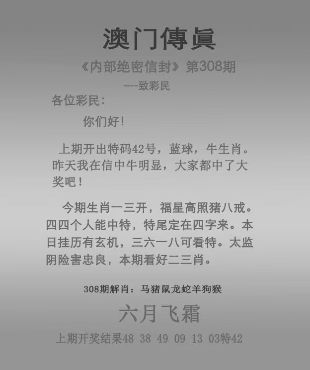
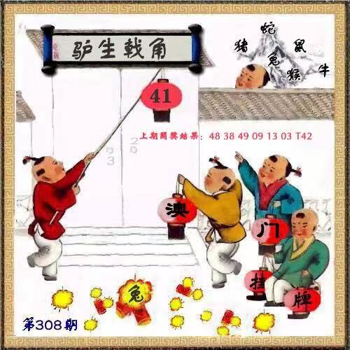

# 2026年第308期

[完整分析v001](分析-v001.md) · [资料说明](资料说明.md) · [预测记录](预测记录.json) · [证据表](证据表.csv)

主蛇鸡鼠牛猪羊，防马猴龙；完整暂定，保留一处疑字，未锁号。

### 管家婆

### 跑马

### 跑狗

### 码头诗

### 澳门传真

### 澳门挂牌

结果：特46鸡、首25马；[开奖结果](开奖结果.md) · [完整复盘](复盘.md)。鸡原主6第2位，46未列有效观察号，不采用排除暗码；原暂定分析保留。
