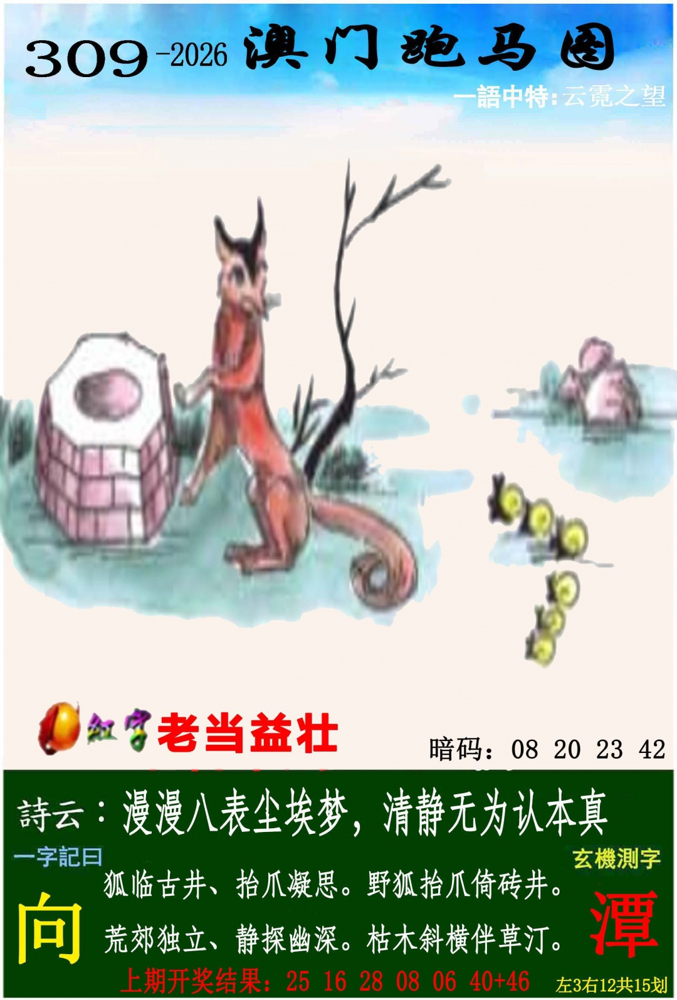
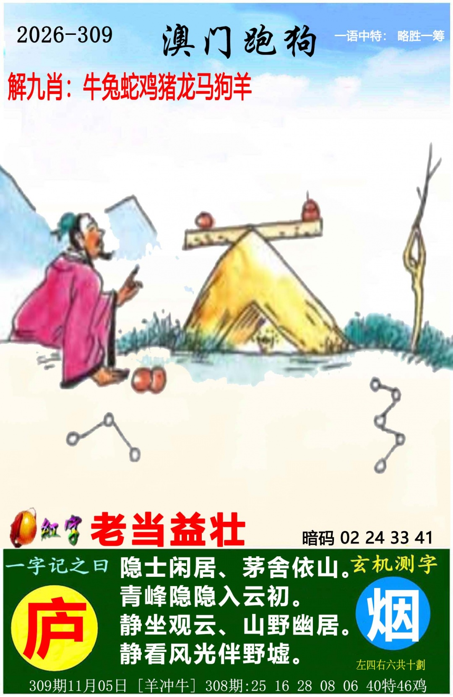
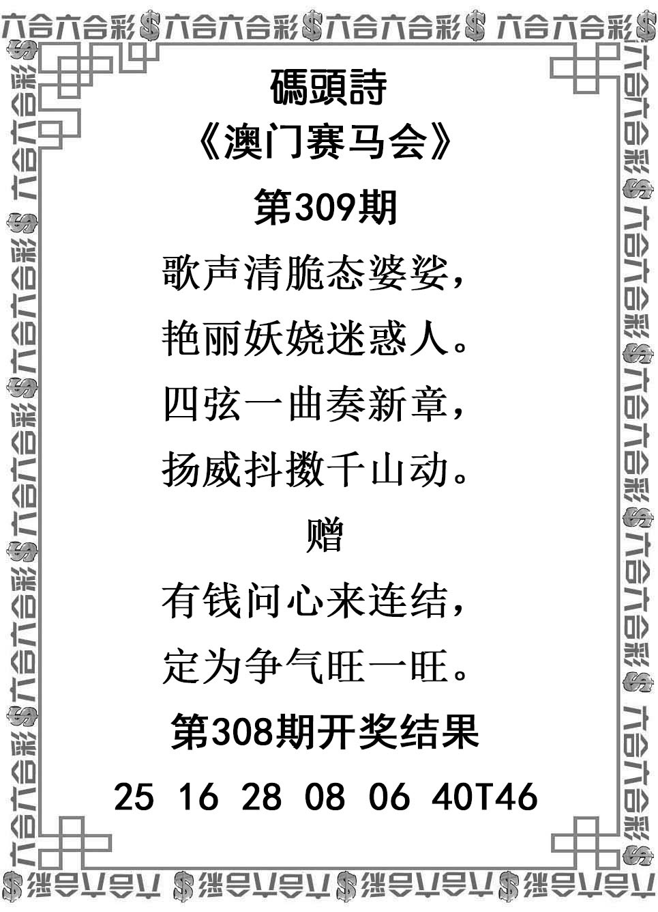
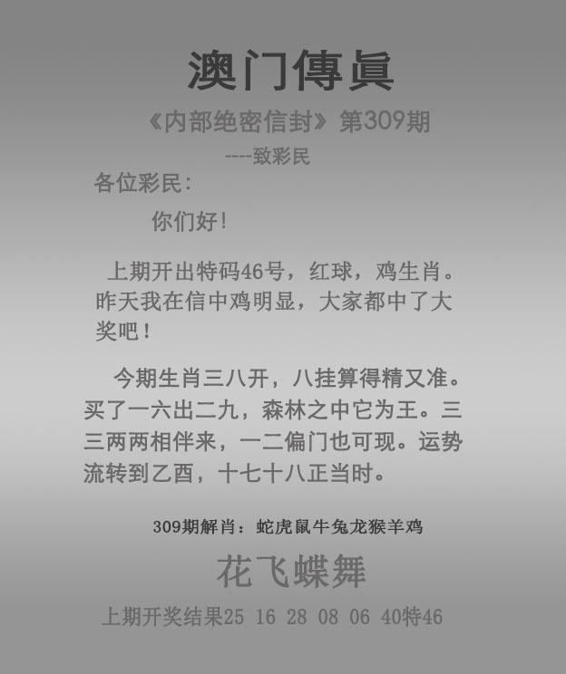

# 2026年第309期

[完整分析v001](分析-v001.md) · [资料说明](资料说明.md) · [预测记录](预测记录.json) · [证据表](证据表.csv) · [完整性检查](资料检查.json) · [复盘](复盘.md)

主六肖：鸡、虎、龙、兔、蛇、鼠；防三肖：猴、狗、猪。六图齐全，完整最终版保留非标准词释义边界。首号25马与特46鸡分开；挂18牛、冲羊牛、爆蛇均已记。指定总15龙/10鸡、具体号码与分类均已回填排序，不以历史未中特削弱有效交叉。开奖结果尚未取得；分析不是实际结果。

### 管家婆

### 跑马

### 跑狗

### 码头诗

### 澳门传真

### 澳门挂牌

