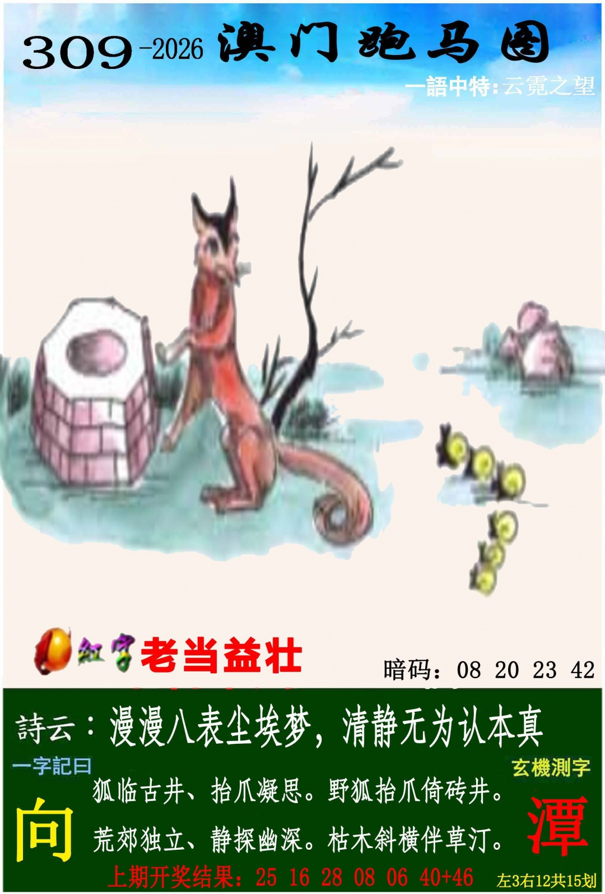
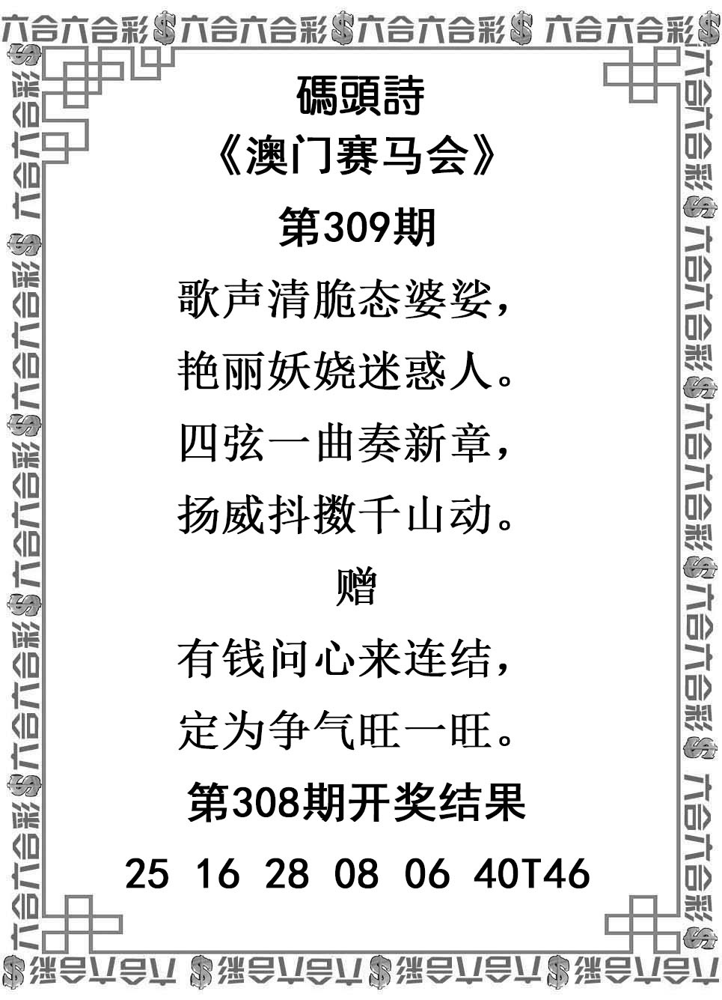
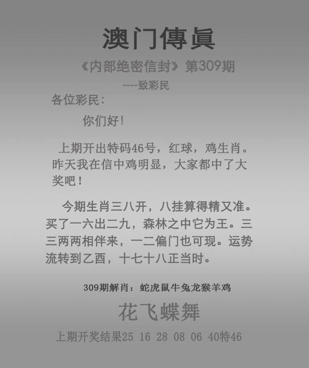

# 2026年第309期资料

来源：本项目本次用户六张PNG附件，原件未改动。精确用户送达时间未知，实际入库/分析时间见时间记录；SHA256见归档信息.json。

有效范围、逐句原文、非标准词及排除区详见[完整分析v001](分析-v001.md)。只取指定总15/10划；暗码与解九肖忽略；挂牌死声淘气、挂18、爆蛇分别处理；传真正文和花飞蝶舞。

### 管家婆

### 跑马

### 跑狗

### 码头诗

### 澳门传真

### 澳门挂牌

