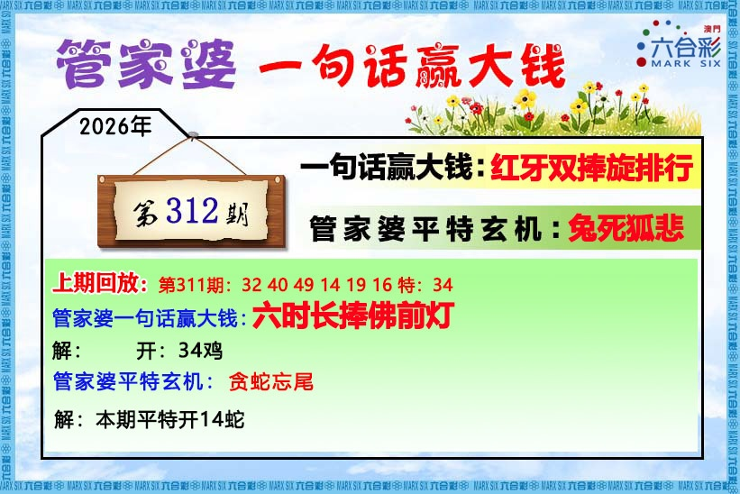
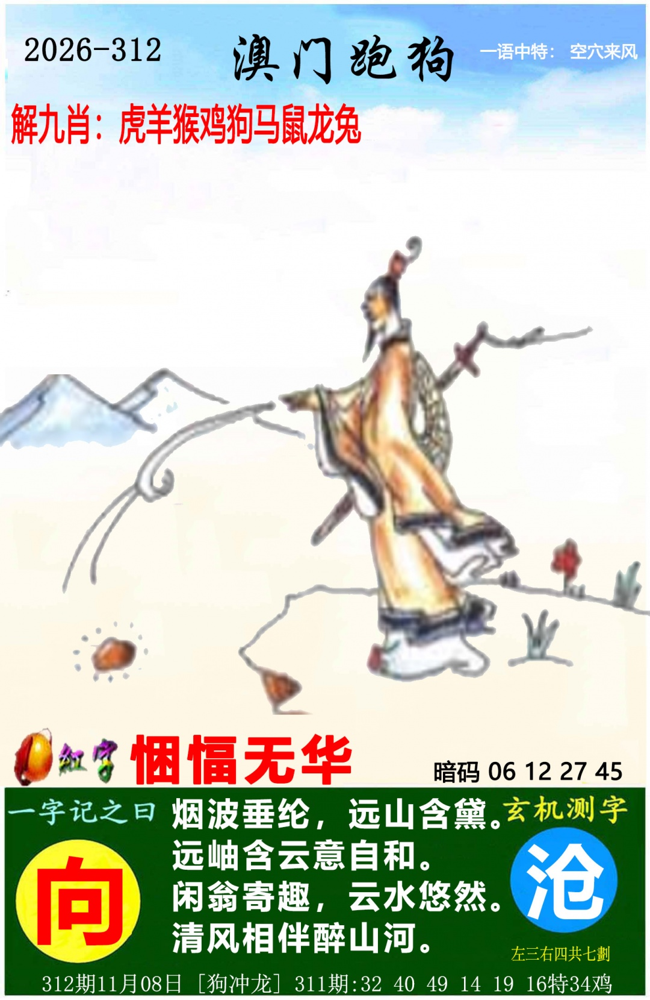
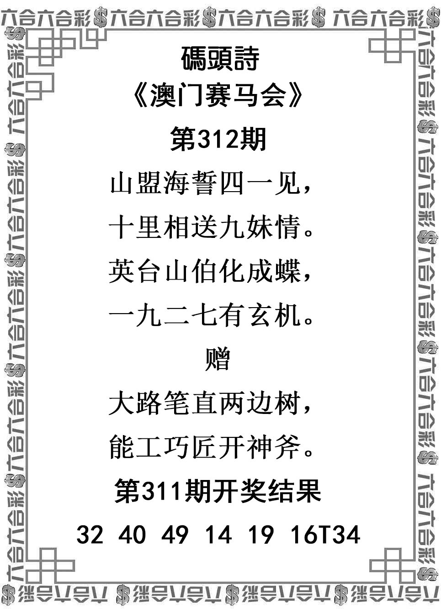
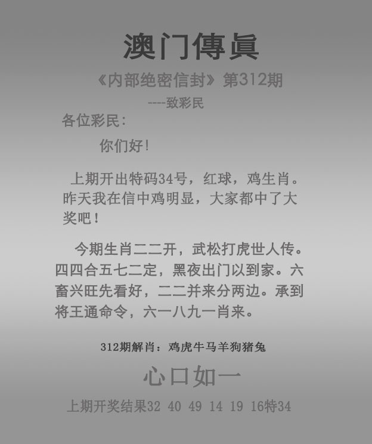
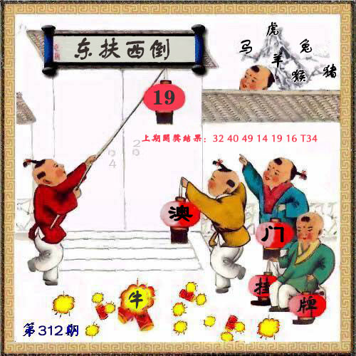

# 2026年第312期

[逐肖总结](总结-v001.md) · [完整分析](分析-v001.md) · [资料说明](资料说明.md) · [证据表](证据表.csv) · [预测记录](预测记录.json) · [复盘](复盘.md)

主鸡、虎、猴、马、兔、蛇，防龙、羊、鼠。六图齐全，完整最终v001，实际正31、46、04、43、32、15，特38蛇，首31鼠。原主6第6位蛇覆盖生肖，原未明确给出38。

[实际结果](开奖结果.md) · [六图及逐肖复盘](复盘.md) · [44项复盘审计](复盘证据审计.csv) · [来源核验](开奖来源/核验记录.json)。原冻结时间凭据未独立认证，不计已认证开奖前成绩。本期原分析的上一期依据为311首32猪、特34鸡；312挂19鼠、爆牛、狗冲龙另列，均不因本次结果回改。

### 管家婆

### 跑马

### 跑狗

### 码头诗

### 澳门传真

### 澳门挂牌

