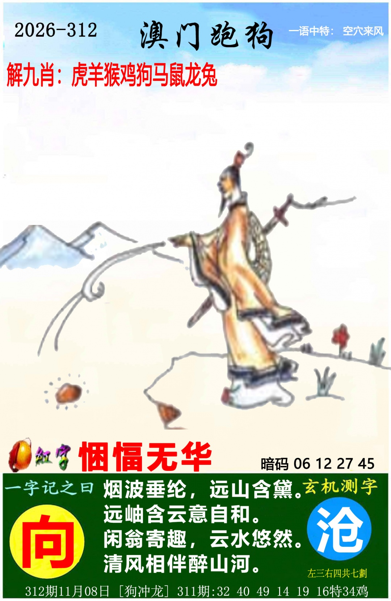
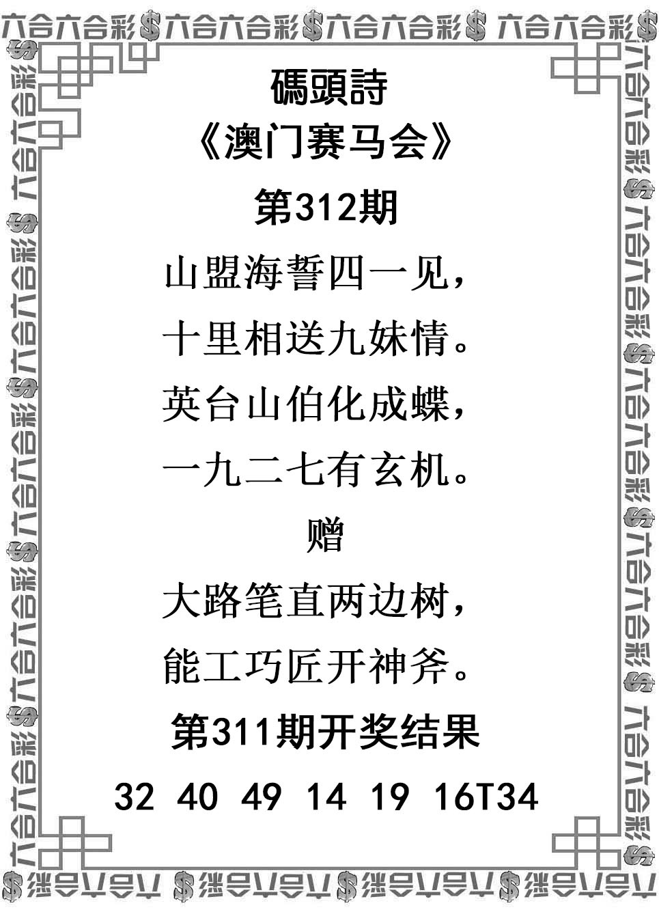
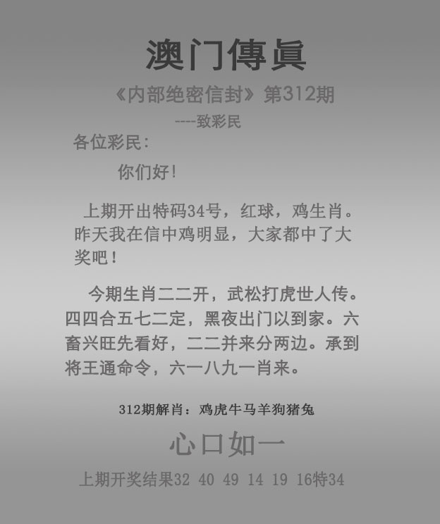

# 2026年第312期资料说明

接收日期按本项目对话2026-11-08登记，精确发图时刻未知；实际保存、核对、形成与冻结时间分别记入时间记录.jsonl，不倒填。本次用户提供6张PNG原件，来源为对话附件，逐张SHA256与临时原件一致，清单见归档信息.json。本次无额外预期图片清单，只就这6图确认范围，不声称所有可能发行资料均已收齐。

311已归档核验正码32、40、49、14、19、16，末尾特34鸡；本次图中回放一致。312使用首32猪最高降权、挂19鼠最高、爆牛次级、狗冲龙两肖次级。未查询312开奖结果。

| 原图 | 当期有效文字与范围 | 不参考内容及限制 |
| --- | --- | --- |
| [管家婆](原始资料/01-管家婆.png) | 红牙双捧旋排行 | 平特兔死狐悲、回放及旧解释排除；旋排行搭配不顺原字保留 |
| [跑马](原始资料/02-跑马.png) | 市井之臣；悃愊无华；碧城冷落空蒙烟，烛摇斜吹泪空煎；行囊在肩，山行踏远。游子行囊向野川。残阳映路，羁客征途。旧笠斜抛荒径上；山、趟，指定总9 | 暗码与左右划数排除；人物是行客但姓名职业不明；不以物件计数 |
| [跑狗](原始资料/03-跑狗.png) | 空穴来风；共用悃愊无华；烟波垂纶，远山含黛。远岫含云意自和。闲翁寄趣，云水悠然。清风相伴醉山河；向、沧，指定总7；狗冲龙 | 暗码、解九肖、左右划数排除；图与正文相照，垂钓者身份不确认 |
| [码头诗](原始资料/04-码头诗.png) | 山盟海誓四一见，十里相送九妹情。英台山伯化成蝶，一九二七有玄机。赠：大路笔直两边树，能工巧匠开神斧 | 311结果只核事实；梁祝按故事语义，不编二人出生肖；神斧不认固定人物 |
| [澳门传真](原始资料/05-澳门传真.png) | 今期生肖二二开，武松打虎世人传。四四合五七二定，黑夜出门似到家。六畜兴旺先看好，二二并来分两边。承到将王通命令，六一八九一肖来；心口如一 | 宣传、旧期开奖解释、解肖排除；四四/五七二按合字分段，末一肖为数量谓语；将王不改君王 |
| [澳门挂牌](原始资料/06-澳门挂牌.png) | 东扶西倒；挂19、爆牛单列降权 | 右上六小、人物动作、淡数字、其他灯笼字样不参考；不改四字为标准成语 |

红牙词义另核为拍板乐器，悃愊无华核为诚实质朴；词典只核释义，生肖、外号、主格、VIP及号码仍取基础资料和决策记录。词义来源与本次核验时间见词义核验.json，不把外部页面的相关词、典故或人名补成本期线索。

### 管家婆

### 跑马

### 跑狗

### 码头诗

### 澳门传真

### 澳门挂牌

