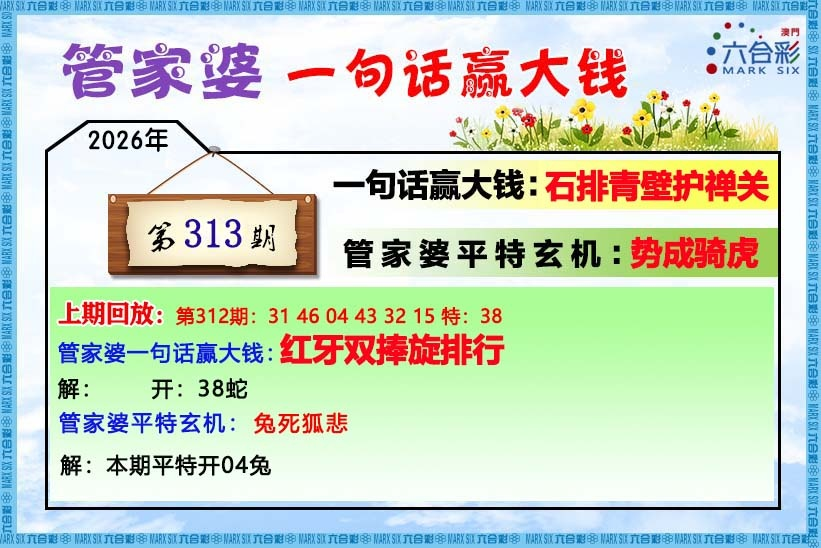
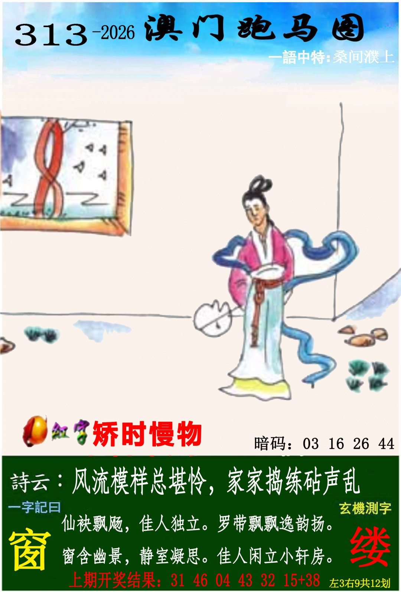
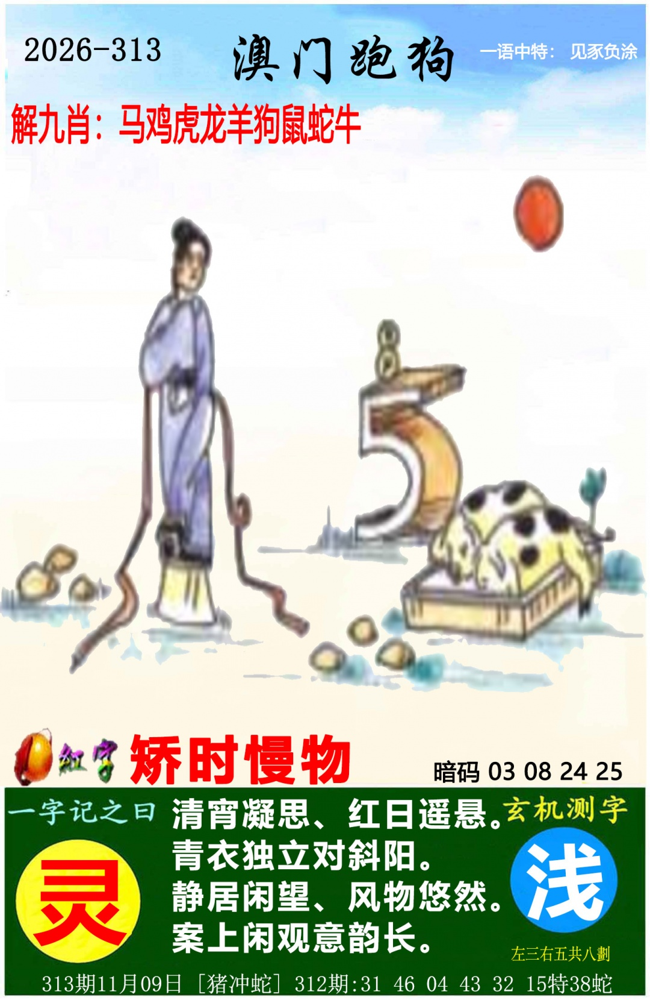
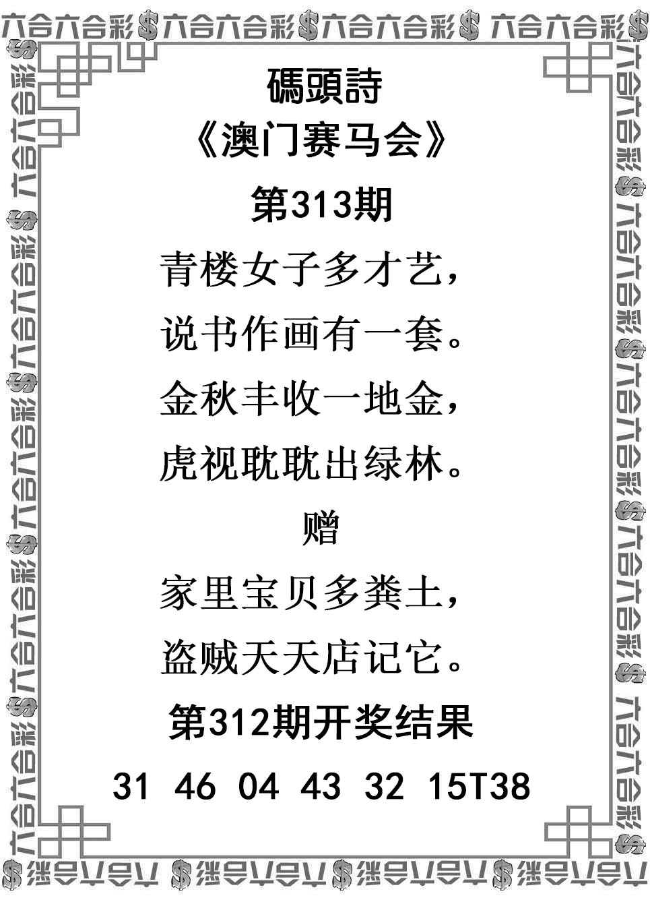
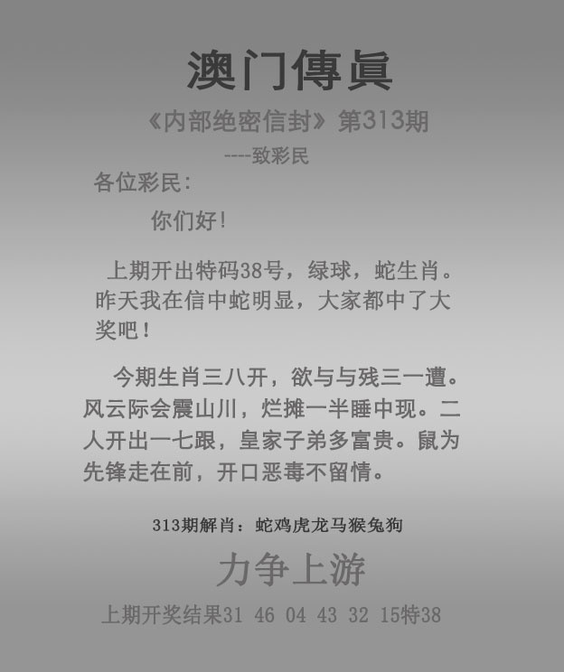

# 2026年第313期

[逐肖总结](总结-v001.md) · [完整分析](分析-v001.md) · [资料说明](资料说明.md) · [证据表](证据表.csv) · [预测记录](预测记录.json) · [完整复盘](复盘.md)

主羊、虎、猪、蛇、龙、鼠；防马、鸡、猴。六图齐且范围确认，完整最终v001，实际正33、39、45、15、07、20，首33狗、特43鼠。原主6第6位鼠覆盖生肖；43只作挂牌降权，原正向观察31并未开出。

[实际结果](开奖结果.md) · [六图及逐肖复盘](复盘.md) · [45项复盘审计](复盘证据审计.csv) · [来源核验](开奖来源/核验记录.json)。原冻结时间未独立认证，不计已认证开奖前成绩。首31鼠与挂43鼠来源分列，爆狗、猪蛇冲均登记；上特38蛇仅记录。

### 管家婆

### 跑马

### 跑狗

### 码头诗

### 澳门传真

### 澳门挂牌

