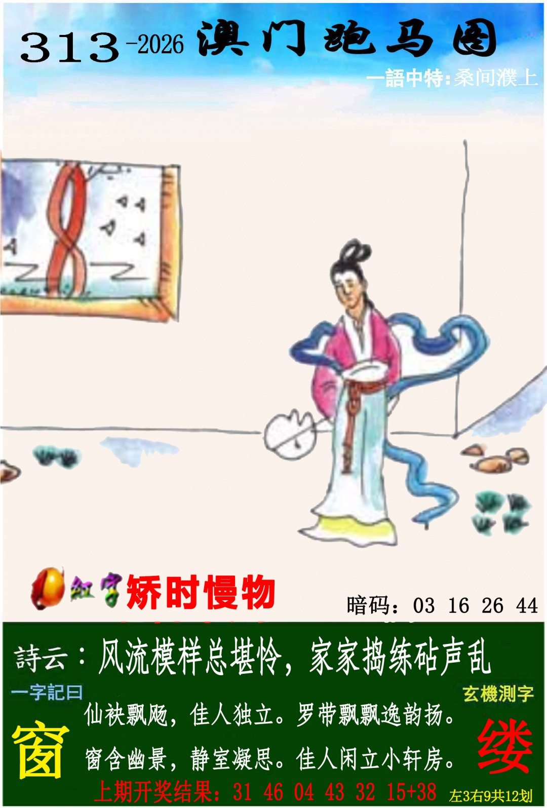
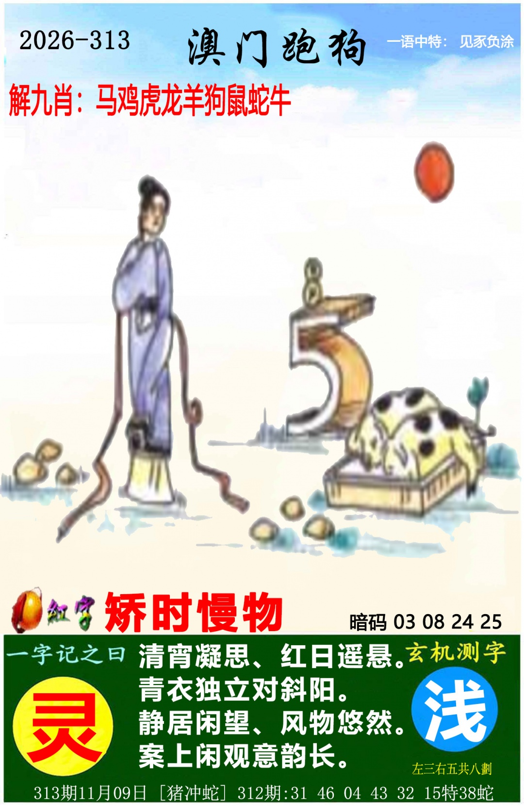
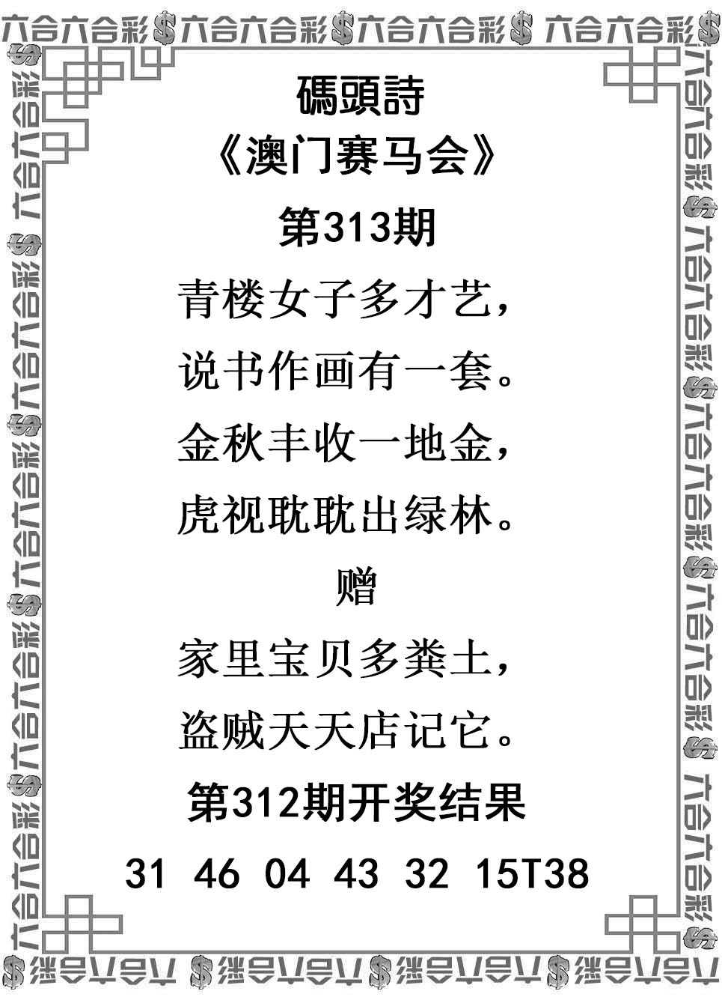
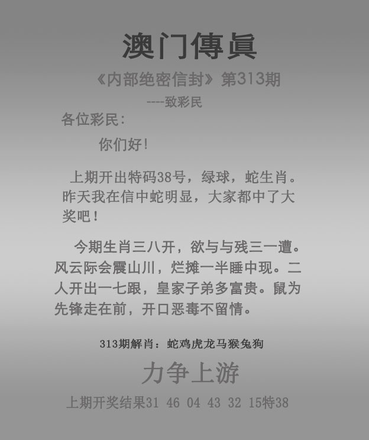

# 2026年第313期资料说明

本次用户对话于2026-11-09提供6张PNG，精确发图时刻未知；实际复制、核对、分析形成和冻结时间分别记时间记录.jsonl，不倒填。本次六图依既有资料类型规则确认范围，无另外预期清单，不声称所有可能发行图均已收齐。原件与附件SHA256一致，清单见归档信息.json。

上期312正码31、46、04、43、32、15，首31鼠、特38蛇，本地已核验记录与本次回放一致。313固定降权：首31鼠最高、挂43鼠最高，分别记源不自造加倍惩罚；爆狗次级；猪冲蛇两肖次级。未查询313结果。

| 原图 | 有效文字与图意 | 排除及限制 |
| --- | --- | --- |
| [管家婆](原始资料/01-管家婆.png) | 石排青壁护禅关 | 势成骑虎在平特区不看；回放与旧解释排除 |
| [跑马](原始资料/02-跑马.png) | 女像窗景；桑间濮上；矫时慢物；风流模样总堪怜，家家捣练砧声乱；仙袂飘飏，佳人独立。罗带飘飘逸韵扬。窗含幽景，静室凝思。佳人闲立小轩房；窗、缕，总12 | 暗码、左右划数、物件数量不看；飘/闲字局部字体辨读限制，职业婚姻不明，帘结像8仅弱疑形 |
| [跑狗](原始资料/03-跑狗.png) | 女像、红日与案景；见豕负涂；共用矫时慢物；清宵凝思，红日遥悬。青衣独立对斜阳。静居闲望，风物悠然。案上闲观意韵长；灵、浅，总8；猪冲蛇 | 暗码、解九肖、左右拆分排除；斑点卧物不确认猪虎；5样架形及8样饰物仅弱疑形、不拼58/85；清宵与日景矛盾保留 |
| [码头诗](原始资料/04-码头诗.png) | 青楼女子多才艺，说书作画有一套。金秋丰收一地金，虎视眈眈出绿林。赠：家里宝贝多粪土，盗贼天天惦记它 | 非标准家财土句保留原字，财富/农家肥土为两种语义，不改句；旧结果仅核事实 |
| [澳门传真](原始资料/05-澳门传真.png) | 今期生肖三八开，欲与与残三一遭。风云际会震山川，烂摊一半睡中现。二人开出一七跟，皇家子弟多富贵。鼠为先锋走在前，开口恶毒不留情；力争上游 | 欲与与残、烂摊等非标准原字不改；宣传回放及解肖不看；二人关系未定 |
| [澳门挂牌](原始资料/06-澳门挂牌.png) | 讳莫如深；挂43鼠、爆狗只作降权 | 六小、人物、淡数字、固定灯笼和水印排除；挂号不兼正向号码票 |

词典只核词义，不提供生肖或号码映射。词义来源见词义核验.json，生肖分类、主格、VIP、尾字、号码仍依基础资料与决策记录。完整分析、逐肖总结与42项证据分别保存。

### 管家婆

### 跑马

### 跑狗

### 码头诗

### 澳门传真

### 澳门挂牌

