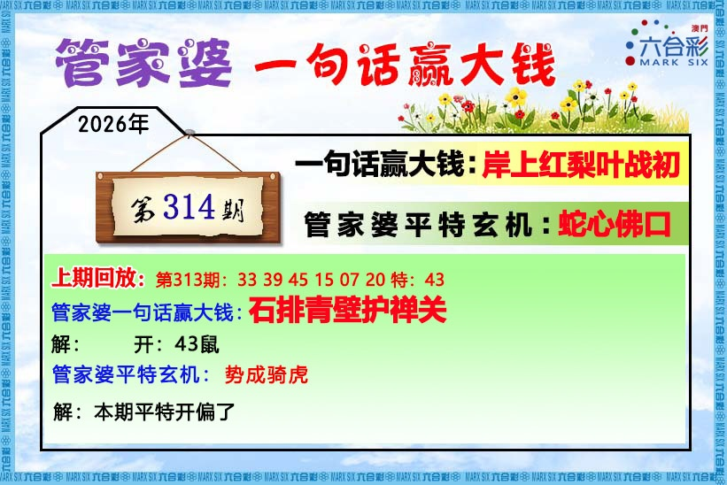
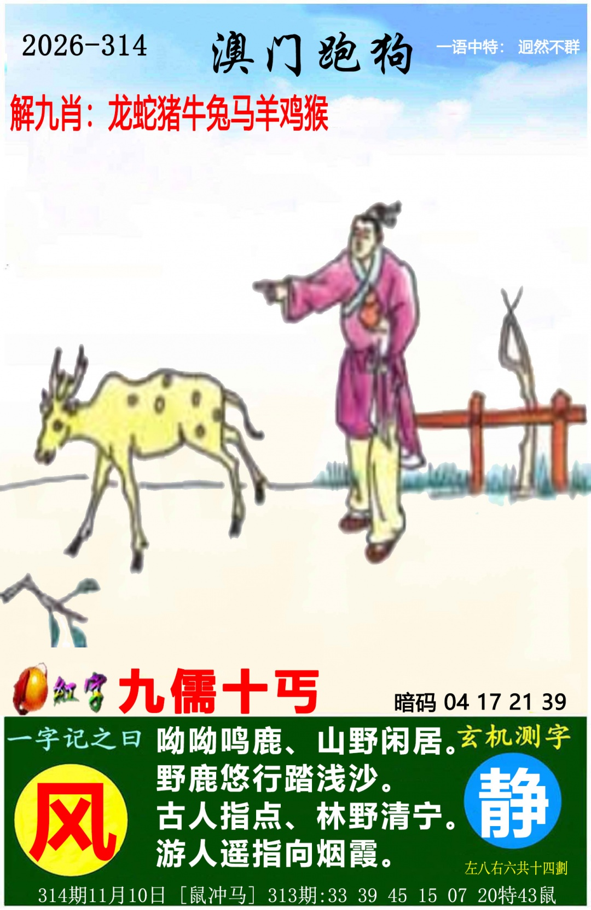
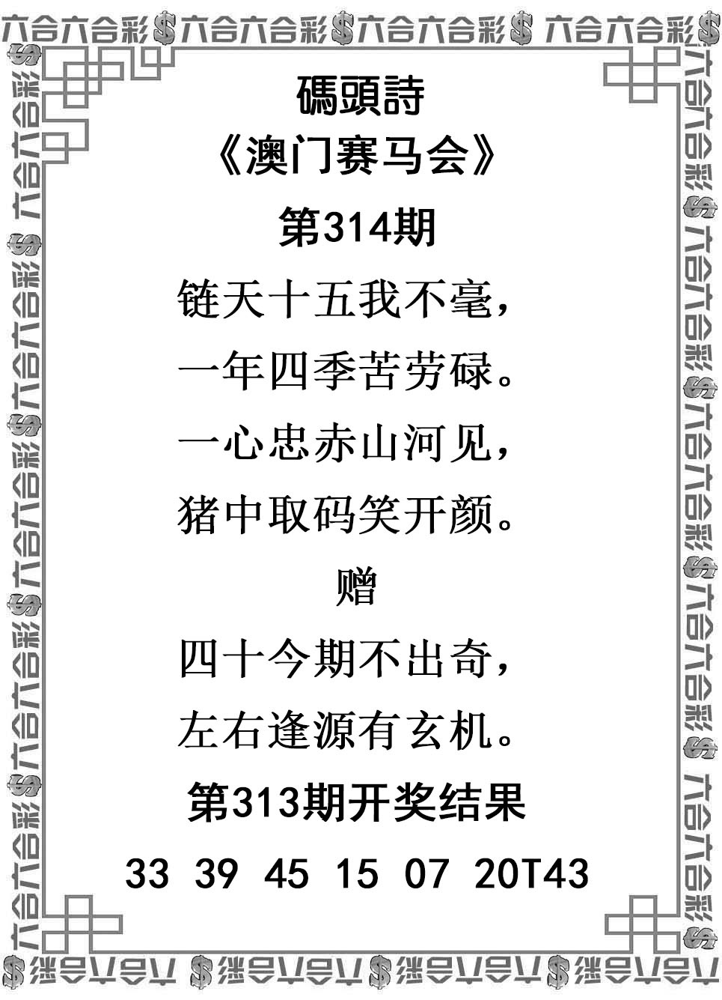
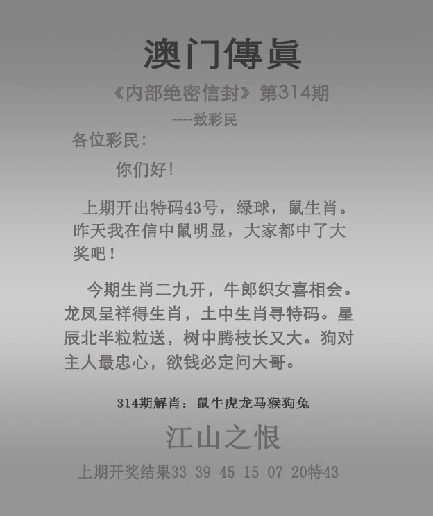
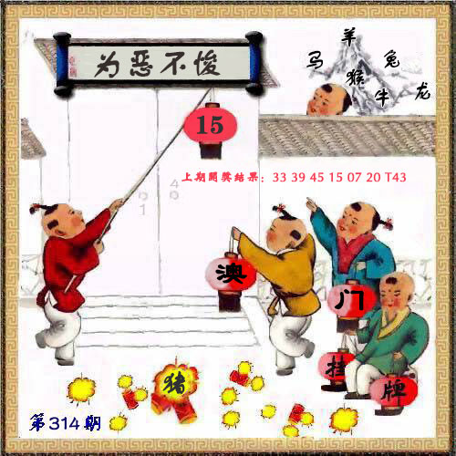

# 2026年第314期

[逐肖总结](总结-v001.md) · [完整分析](分析-v001.md) · [资料说明](资料说明.md) · [证据表](证据表.csv) · [预测记录](预测记录.json) · [完整复盘](复盘.md)

主马、牛、羊、猴、龙、蛇；防狗、猪、兔。六图齐，完整最终v001；实际正13、26、09、37、34、44，首13马，特31鼠。原鼠在九肖外，主6防3均未覆盖；31未正向给出。

[真实结果](开奖结果.md) · [六图及逐肖复盘](复盘.md) · [46项审计](复盘证据审计.csv) · [来源核验](开奖来源/核验记录.json)。原版本及冻结不改，pre_draw_proven=false，不计已认证开奖前成绩。首33狗、挂15龙最高；爆猪、冲鼠马次级；上特43鼠仅记录。

### 管家婆

### 跑马

### 跑狗

### 码头诗

### 澳门传真

### 澳门挂牌

