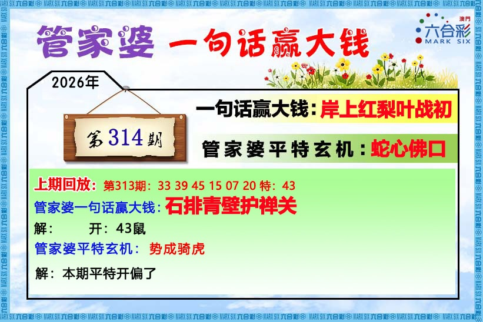
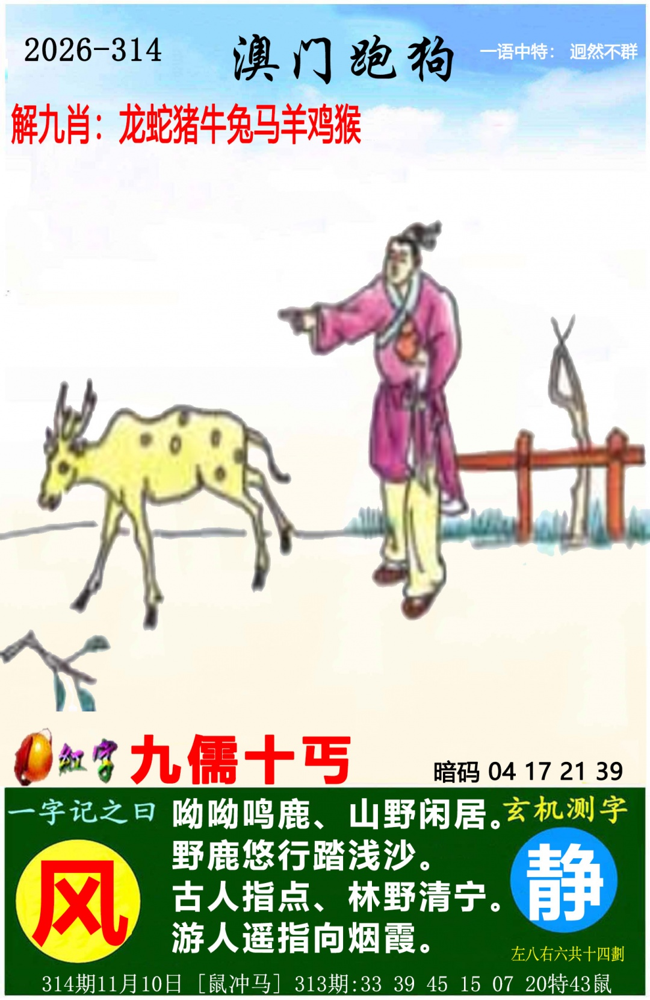
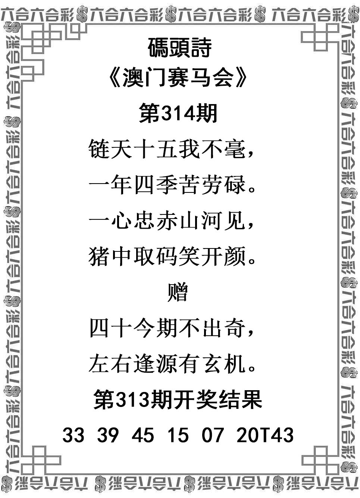
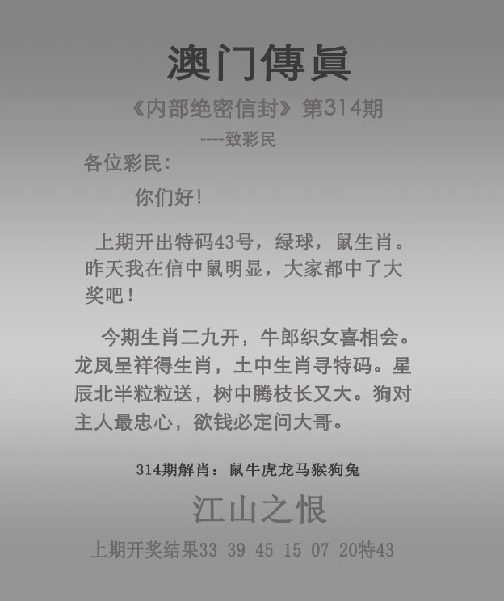

# 2026年第314期资料说明

来源：本次用户对话6张PNG原件。图注314期11月10日；实际归档日期2026-11-10，复制和分析形成事件用真实北京时间记录，不倒填用户发图时分。原文件路径与SHA256见归档信息.json，原图嵌入见本期README。

有效范围、逐句原文与不确定项见分析-v001.md第一、二、七节；检查表记录六图齐、313首33狗核验与当期五项降权。

管家婆只当期一句话；传真正文和江山之恨；挂牌仅为恶不悛、15与爆猪只降权。两图暗码、解九肖、回放及挂牌六小人物排除。九儒十丐只一次；跑马总9、跑狗总14不拆左右。码头首字暂链、部分字体/搭配不顺保留；关键数字及鹿/牛/织女/龙/猪/狗字义可核，无需依疑字定主防。

## 管家婆

## 跑马

## 跑狗

## 码头诗

## 澳门传真

## 澳门挂牌

