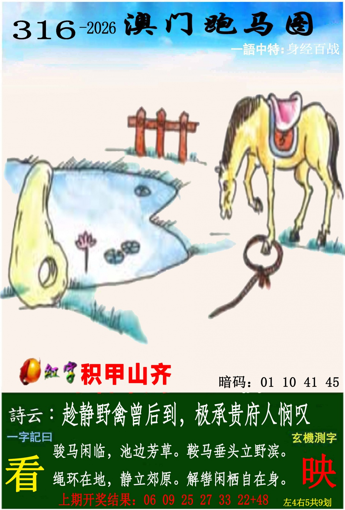
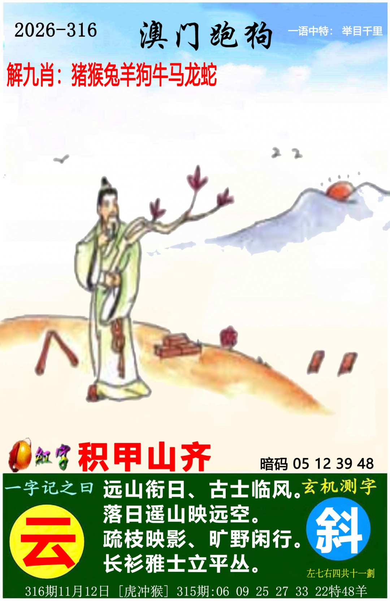
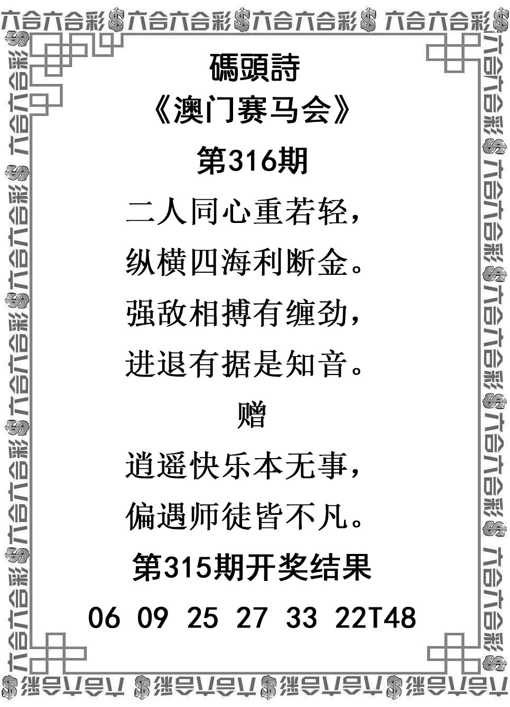
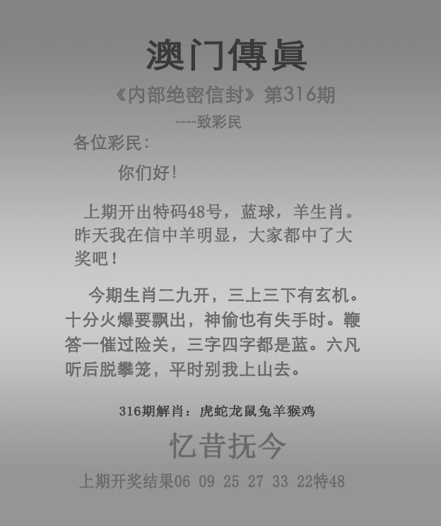

# 2026年第316期资料说明

本次对话六张PNG原件；实际保存时间见归档信息及时间记录。对话精确接收时间未知，不倒填。图注316期11月12日。未查询316开奖结果。

315上期：06、09、25、27、33、22，特48；首06牛与特48羊分开，已和本地315核验存档一致。本期首牛/挂30牛最高；爆蛇和虎冲猴次级。

## 管家婆

仅屏山外翠禽声小；平特、回放及宣传全部排除。

屏山外翠禽声小。

## 跑马

主图、身经百战、诗文、看、映总9；积甲山齐与跑狗共计一次。

身经百战。积甲山齐。趁静野禽曾后到，极承贵府人惘叹〔后句识读/句意存疑〕。骏马闲临，池边芳草。鞍马垂头立野滨。绳环在地，静立郊原。解缰〔缰字待确认〕闲栖自在身。大字看；测字映，总9。

## 跑狗

主图、举目千里、诗文、云、斜总11、底部虎冲猴；暗码及解九肖排除。

举目千里。积甲山齐〔共用只算一次〕。远山衔日，古士临风。落日遥山映远空。疏枝映影，旷野闲行。长衫雅士立平丛。大字云；测字斜，总11。底部虎冲猴。

## 码头诗

四句正文及两句赠言；回放仅核验上期。

二人同心重若轻，纵横四海利断金。强敌相搏有缠劲，进退有据是知音。赠：逍遥快乐本无事，偏遇师徒皆不凡。

## 澳门传真

当期四联正文与忆昔抚今；解肖、宣传、回放排除。

今期生肖二九开，三上三下有玄机。十分火爆要飘出，神偷也有失手时。鞭答一催过险关，三字四字都是蓝。六凡听后脱攀笼，平时别我上山去。四字：忆昔抚今。

## 澳门挂牌

仅点头称善；挂30、爆蛇仅降权；其余画面、六小和固定字样排除。

点头称善。挂30牛、爆蛇仅作降权。

## 识读边界

- 跑马诗云第二句暂录极承贵府人惘叹，末字惘叹识读/句意存疑，不用疑字锁肖；首句保留趁静野禽曾后到
- 跑马末句暂录解缰闲栖自在身，缰字细部不够清；只用解开缰绳的图文共同语境，不另计字形
- 传真可见二九开、要飘出、鞭答、六凡、脱攀笼、平时别我；保留原字，不改成三九/鞭策/樊笼等熟句
- 跑狗人物只认古士/雅士，不命名具体人物；普通飞鸟不指定品种；跑马池花作荷花图像对应，保留低清花型边界
