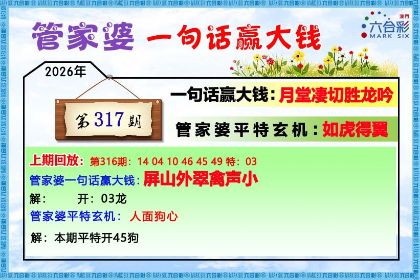
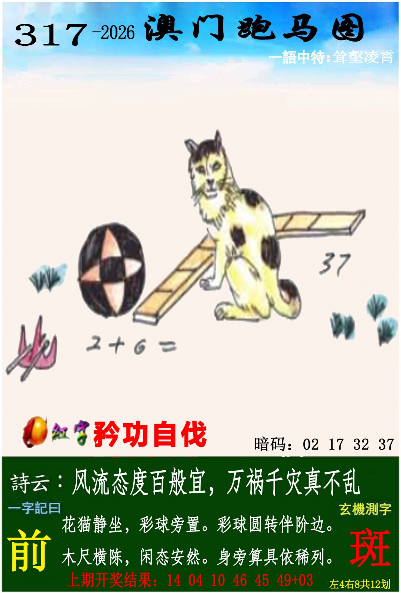
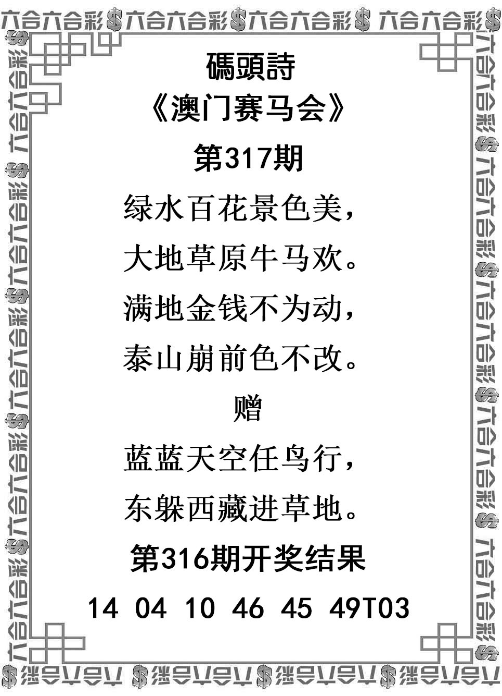
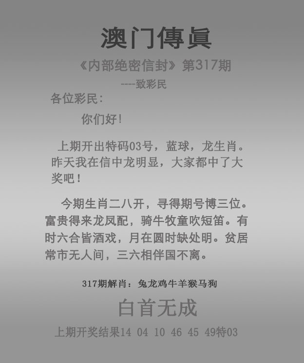

# 2026年第317期资料说明

本次对话六张PNG原件，图注317期11月13日。实际保存/形成时间见归档信息和时间记录；对话精确接收时间未知，不倒填。未查询317开奖结果。

316实际正14、04、10、46、45、49，首14蛇、特03龙。跑狗本期旧回放误印特48羊，保留原件但不改真实记录、不当317线索。其余图回放与已核验实际结果一致。

本期首14蛇/挂05虎最高；爆猴、兔鸡冲次级。316挂30牛/爆蛇/虎猴冲不带入。

## 管家婆

有效范围：仅月堂凄切胜龙吟；平特如虎得翼、回放、宣传排除。

可见文字：月堂凄切胜龙吟。仅此当期一句；平特如虎得翼排除。

## 跑马

有效范围：主图及其显式37、2+6=；上角首两字待辨的凌霄句；诗文、前、斑指定总12；矜功自伐共用只计一次；暗码排除。

可见文字：右上：〔首两字待辨〕凌霄。共用：矜功自伐。诗云：风流态度百般宜，万祸千灾真不乱。正文：花猫静坐，彩球旁置。彩球圆转伴阶边。木尺横陈，闲态安然。身旁算具依稀列。主图显式37、2+6=。左大字前，测字斑总12。暗码全部排除，不能用暗码中的37额外加权。

## 跑狗

有效范围：主图、娟好静秀、诗文、间、随指定总11、底部兔冲鸡；解九肖及暗码排除；共用四字不再加权。

可见文字：右上：娟好静秀。共用矜功自伐只计一次。远山含黛，素袂红衣。红衫轻立对遥山。枯枝伴影，秋意悠悠。疏木孤枝伴翠萱。左大字间，测字随总11。底部兔冲鸡。解九肖、暗码排除；316回放印特48羊为错印，不作317线索。

## 码头诗

有效范围：正文和赠言；316回放仅核实前期事实。

可见文字：绿水百花景色美，大地草原牛马欢。满地金钱不为动，泰山崩前色不改。赠：蓝蓝天空任鸟行，东躲西藏进草地。

## 澳门传真

有效范围：当期正文和白首无成；解肖、回放、宣传排除。

可见文字：今期生肖二八开，寻得期号博三位。富贵得来龙凤配，骑牛牧童吹短笛。有时六合皆酒戏，月在圆时缺处明。贫居常市无人问，三六相伴国不离。四字：白首无成。保留常市、国不离原字。

## 澳门挂牌

有效范围：仅挂印悬牌；05及爆猴仅降权；人物、六小、淡字及固定字样忽略。

可见文字：四字挂印悬牌；挂05虎、爆猴仅降权；其他人物、六小、淡字及固定字样排除。

## 识读和事实边界

- 跑马右上首两字字体不清，暂录〔首两字待辨〕凌霄；不擅改词典耸壑凌霄，更不按疑字算笔画
- 传真保留期号博三位、贫居常市、三六相伴国不离等非标准原字，不自动改成闹市或团
- 跑狗底部316回放最后印特48羊，和已核验03龙不符；六码14/04/10/46/45/49一致，首14蛇未受影响。只存图片印字差异，不改真实结果，不作317线索
- 图中是花猫（正文确认），不是明虎；猫类表与兔猫VIP分开，人物不认特定古人，树枝不认桃梅，物件不计数
