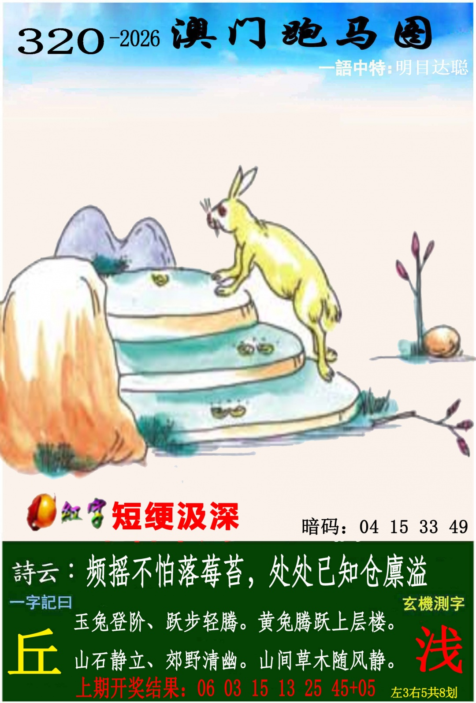
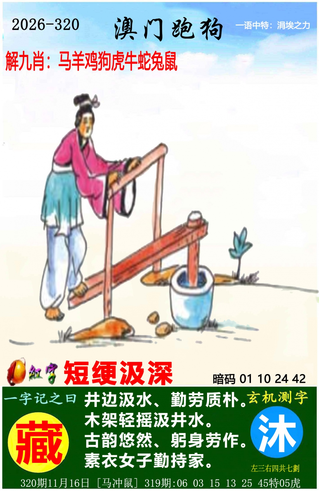
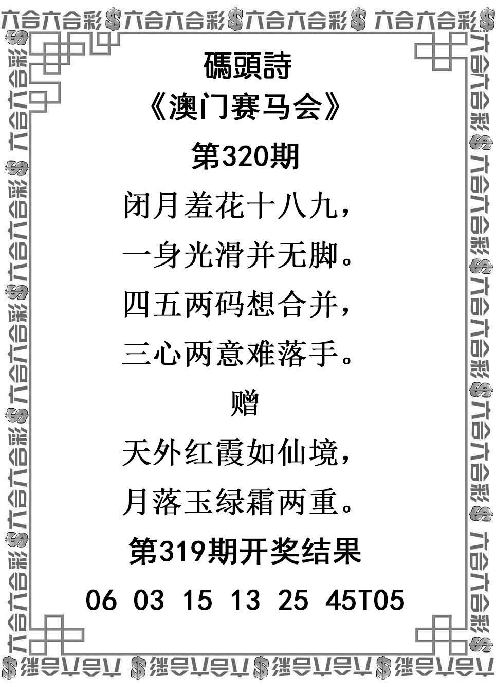
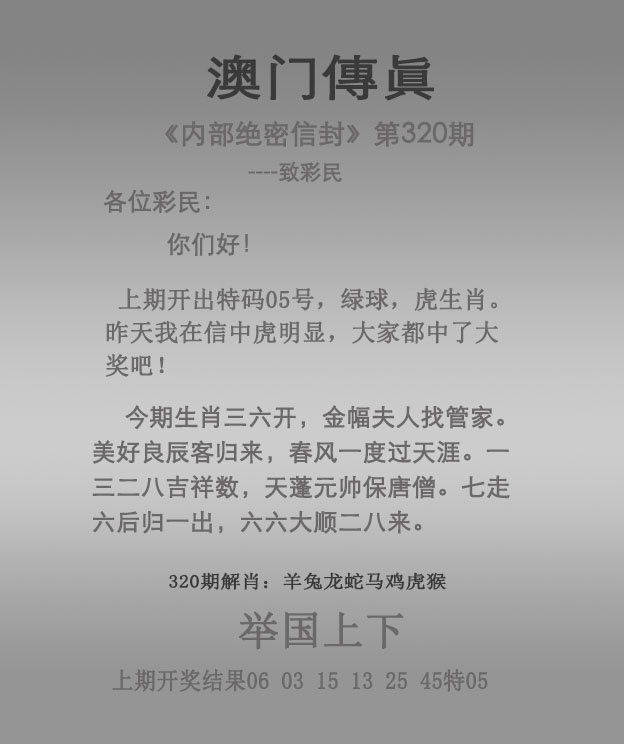

# 2026年第320期

六张用户原图齐，完整分析v001已形成；未查询320结果，待核验后逐版复盘。

**主6：蛇、兔、猪、狗、羊、龙。防3：马、鼠、牛。其余：鸡、虎、猴。**

319首06牛最高；本期挂46鸡最高、爆鼠次级、马冲鼠两方次级。上特05虎仅记录。

- [完整七项分析](分析-v001.md)
- [R19逐肖总结](总结-v001.md)
- [逐图资料与原字疑点](资料说明.md)
- [证据CSV](证据表.csv) · [资料检查](资料检查.json)
- [预测版本](预测记录.json) · [时间记录](时间记录.jsonl)
- [冻结分析](冻结记录/v001/分析.md) · [冻结凭据](冻结记录/v001/凭据.json)
- [归档与SHA256](归档信息.json) · [词义核验](词义核验.json)

实际形成时间：2026-11-16T18:48:39+08:00。精确消息接收时间未知，不倒填；冻结只证明保存时存在，不独立认证开奖前成绩。主防为图文线索排序，不代表经过验证的开奖概率，未锁定唯一号码。

## 六张原图

### 01-管家婆

SHA256：`a069ab13caac8e46ee4f427589cd95cc7ddadc180c6c443ead160406b61b071d`

### 02-跑马

SHA256：`50e8268a90f224b6c7f4ee71dd013cdf4efe228288368670c1c01940b132d484`

### 03-跑狗

SHA256：`efdf2c92baaf588db85a206ec55a7bc669a54a4178605b835ecf5b3276b0a7ed`

### 04-码头诗

SHA256：`994db9d6224e1f0537ef48331a321fca1a4c168fbffea51e91c075291cddf9c1`

### 05-澳门传真

SHA256：`9e10efc4d322bc282cd380ef87baac3ce390323a12274d796d9970ccda39ff6c`

### 06-澳门挂牌

SHA256：`45830354e1a2f4f3988987e29e1bab9b34298e3d9fa3a8d6697bd2c6fcdd212b`
