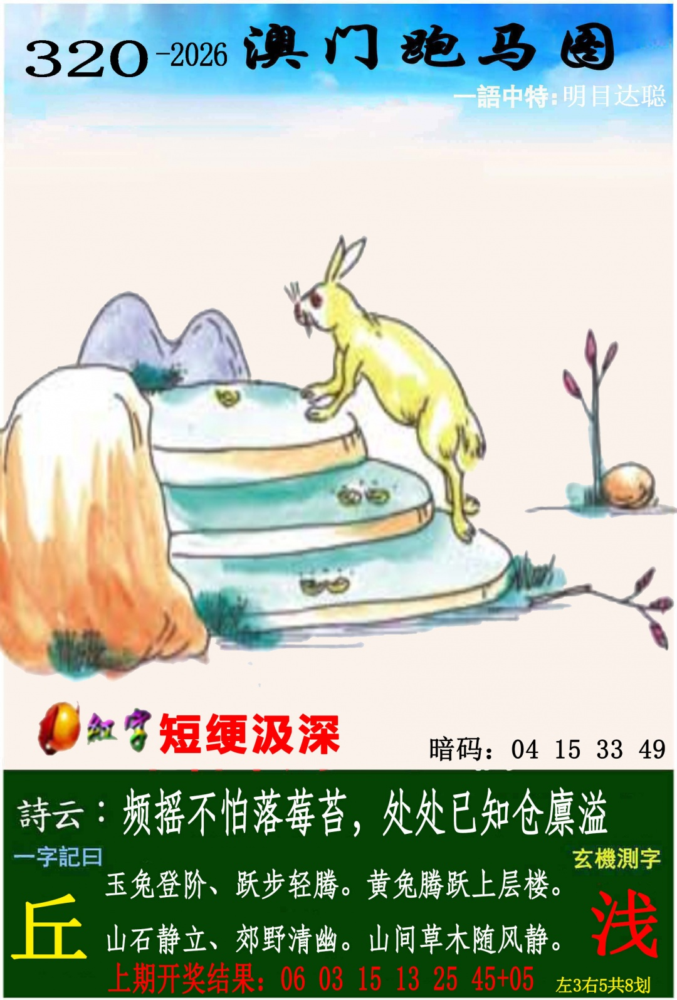
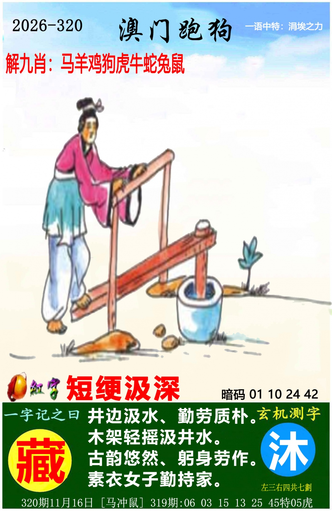
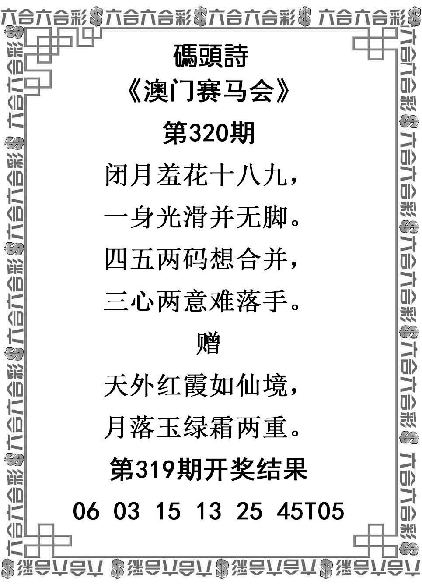
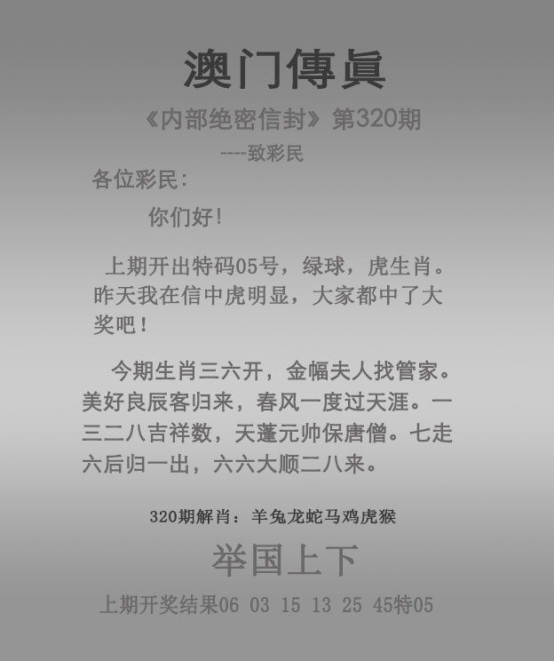
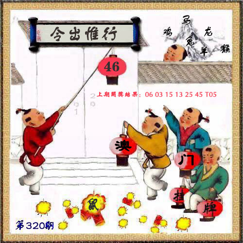

# 2026年第320期资料说明

来源：本次对话用户上传六张PNG原件。精确消息接收时刻未知；实际原件保存时间为2026-11-16T18:32:54+08:00。未查询320开奖结果，旧回放只核319首特。原字与有效范围如下；原图SHA256见文末及归档信息。

## 一、资料识别、有效范围与前期首号

六图均标2026年第320期，跑狗日期11月16日。319已存实时/单期原响应核验结果为正06牛、03龙、15龙、13马、25马、45狗，**首06牛、特05虎**；本次各图回放一致。牛因首号最高降权，虎不因上期特码降权。

| 资料 | 当期有效内容 | 排除部分 |
| --- | --- | --- |
| 管家婆 | 来驾火龙离九〔末字待辨〕 | 平特气壮如牛、宣传、旧回放解释 |
| 跑马 | 兔登阶图、明目达聪、诗文、丘、浅总8；共用短绠汲深 | 暗码全排除，左右3/5不拆；图中物件不计数 |
| 跑狗 | 女子汲井水图、涓埃之力、诗文、藏、沐总7、底部马冲鼠 | 解九肖/暗码排除，左右3/4不拆；共用四字不再加票 |
| 码头诗 | 四句正文及两句赠言 | 319回放只核事实 |
| 澳门传真 | 当期正文及举国上下 | 解肖、宣传、上期回放 |
| 澳门挂牌 | 令出惟行；46、爆鼠仅降权 | 人物动作、六小、淡数字、固定字样 |

管家婆末字放大仍不稳，不直接改成“阙”并引九阙宫廷。传真“金幅”保留幅字，不擅改福/蝠；码头“玉缘”等非标准原字照录。上述疑字均单列，不妨碍其他可辨正文分析。

## 二、逐图、逐句、逐字释义及对应

### 1. 管家婆：来驾火龙离九〔末字待辨〕

先按可辨部分理解为乘驾火龙而来/离开的动态情景；末字未定，整句语法不强补。来是来临，驾是驾驭、乘驾，火为火焰/火性，龙是明写龙，离是离开，九是数提示。**龙字保留，火肖蛇马同时查**；驾驭语境辅助马，但驾不等于明确画马。

九查第九猴、同号09狗；不要把九只算猴漏09狗，也不由末字猜笔画。若比较号码，03龙为皇帝、蓝波、佛灯火，可与火和别图命令/举国语境比较；27龙国君、15龙状元、39龙梨花仍有竞争，泛火与权威不等于已明报03。平特一肖“气壮如牛”整个排除，不能用它补牛。

### 2. 跑马

**图画与正文主体**：一只长耳兔前爪搭阶沿、向上跳，旁有山石、草木及不明小物。正文“玉兔、黄兔”确认兔，不根据黄色另改成别生肖或指定号码波色；不数台阶、草枝、物件。玉兔可查兔VIP月宝、嫦娥及04兔玉帝的“玉”身份条件，但玉兔不等于原文已写玉帝。耳可弱查鼠VIP耳，不能把兔长耳算成明鼠；同一兔图与说明归一组。

**明目达聪**：先理解为看得清、听得明、耳目通达。明目查目肖马羊；聪为听觉，查听肖兔狗，耳可查鼠VIP。若引申为察知政事，只作与挂牌命令的弱呼应，不由“明”补朱元璋、不将丘补孔丘。这里没有指定人物姓名。

**短绠汲深（跑马/跑狗共用一次）**：绠为汲水绳，字面是短绳取深井水，整体比喻能力不足以完成任务，并非已经成功汲到深水。已核[教育部词义](https://dict.revised.moe.edu.tw/dictView.jsp?ID=48322)。短可查短肖羊狗，汲/深水查水肖鼠猪；绳不以形状强认蛇。词义中的不足不新增任何固定降权。与跑狗实际汲水动作交叉，但共同四字仍只有一组。

**频摇不怕落莓苔，处处已知仓廪溢**：按可辨原字理解为反复摇动、不惧落于莓苔，处处知道粮仓满溢。频摇是动作，不能只因摇就确定蛇形或醉态；不怕可辅助胆大牛虎马猴狗猪。莓苔是地面草苔，不是图中已见具体花种。仓廪溢是粮食充足，可查富肖猴牛、福肖羊鸡狗猪，并与传真管家、持家粮食语境比较；未写偷粮，不把粮仓自动等神偷鼠。也不按“频/摇/廪”等字笔画猜肖。

**玉兔登阶，跃步轻腾。黄兔腾跃上层楼。** 整体为兔登台阶，轻快跳高。玉兔/黄兔/图中兔是同一主体，不当三份独立证据；轻快可辅助快肖猴兔，登高/层楼与远山不是同一词，不能自动加边远肖。兔明确、快类不独占。

**山石静立，郊野清幽。山间草木随风静。** 整体是山石、郊野、草木与风的宁静环境。山查鼠虎兔羊猴鸡猪；野查鼠虎兔龙蛇猴；草可辅助吃草牛马羊兔，风查鼠牛与兔VIP；土石可弱查土牛龙羊狗。随风不是“忠”，静不等于固定蛇或猪。木肖虎兔与纳音木仅属性比较，不确认树种。

**丘、浅及指定总8**：丘是土丘，与同图山石环境归组，不擅补孔丘；浅是浅深相对，与短绠深井有对照。指定总8只查08猪（西宫、红波、平地木）和第八羊；左右3与5完全不拆。丘字不另数笔画。

### 3. 跑狗

**画面**：古装女子操作木架、长杆与井口/容器汲水，图有石头、草木。正文明确井边汲水，不凭长杆形状当蛇，也不指定人物姓名或婚姻。女肖兔蛇羊鸡猪；女子劳作持家再查家肖，女/家交集羊鸡猪，但这只是局部交集，不能排掉同时有别条支持的蛇兔。体态秀美可查26蛇美女、28兔小姐、36羊夫人、22鸡贵妃等条件身份，不能从图中服饰确认全部称谓。

**涓埃之力**：涓埃是细微之物，整句说微小的一点力量，已核[教育部“涓埃”](https://dict.revised.moe.edu.tw/dictView.jsp?ID=97519)。先取微小之力，辅助小肖鼠兔龙蛇猴鸡；不能只看三点水/土部首拆成水土生肖，更不能把“力”硬转某个大力神。本期同图又有勤劳动作，弱力和劳作并不互相取消。

**井边汲水，勤劳质朴。木架轻摇汲井水。** 整体是勤劳朴实地操作木架取水。水查鼠猪；勤查勤肖马牛；木查木肖虎兔。图与文字汲水同源，不重复报成两份井证。水、木的不同类别没有共同肖时，各自保留，不能人为造水木唯一交集；08猪/09狗平地木、30牛/31鼠涧下水等是号码属性竞争，木架本身不定具体树种或纳音。

**古韵悠然，躬身劳作。素衣女子勤持家。** 整体为古装女子弯身劳动、维持家务。古韵不是明确琴棋书画；躬身先动作，身肖虎猪仅弱转义，不把猪独锁。素衣是朴素，不必白色，若走白肖只弱查虎兔马羊狗猪；女肖五肖完整保留，持家辅助家肖。另图传真明写夫人36羊，与此女/家身份有跨资料呼应；这比仅凭衣服断夫人更直接。

**藏、沐及指定总7**：藏先解藏匿、收存，可辅助洞中鼠兔蛇狗的隐蔽习性，但没有明写洞穴/神偷，不能把洞类别当明主体。沐是洗浴、受润，与水景同图，不再加一份独立水证。指定总7只查07鼠（国师、红波、壁上土）及第七马；左右3/4不拆，不算藏字笔画。

**马冲鼠**：固定次级对冲两方。马有勤肖、总7位、元帅/13等支持；鼠有水/耳、总7同号、年龄19等支持，均保留。鼠另受爆鼠，分别记录两个来源，不自行乘成双倍概率扣分。

### 4. 码头诗

**闭月羞花十八九**：先读为容貌美丽、年约十八九。美貌查四大美女兔蛇羊鸡、女肖再含猪；闭月虽常与貂蝉典故相连，图中没有明确姓名，不用未知人物出生生肖替代基础表。月查兔月宝/嫦娥，花只是泛花，不锁某花号。十八九优先保留年龄18牛大将、19鼠叛贼；其中“十八”可查1鼠位01马、8羊位08猪、和9猴位09狗；十九是年龄语义还原的条件项，1/9及和10鸡只辅助。不把十八九硬拼成189、89号或新年月。

**一身光滑并无脚**：字面是一身光滑、没有脚的身体形态。十二生肖中蛇的无足形态最明确，优先蛇；龙通常有爪，兔猪等有脚，不能为了其他美貌候选忽略这句。身体光滑并不保证皮肤没有鳞片，亦不等某号码；一弱查鼠位/01马，身肖虎猪仅语词辅助，不能抢过整句蛇形。与前句美貌可落实26蛇美女等身份竞争。

**四五两码想合并**：整体提示四、五两个数合在一起。45狗（菊花、红波、大海水）必须纳入；4查兔位/04兔，5查龙位/05虎，和9查猴位/09狗。两码是数量，不拼成452或524，不倒拼54。45狗和09狗是不同号码，不把它们混称同号；与传真管家33狗是同生肖不同身份的交叉。

**三心两意难落手**：整体是犹豫不定、难下决定。心按蛇VIP“心”查，3虎位/03龙、2牛位/02蛇作为数字辅助；三与两隔词，不硬合32猪；不把“难落手”当固定杀号。三心与两意的拆字分支归同句，不算多张资料。

**天外红霞如仙境**：天空红霞仿佛仙境。天肖小表龙鸡、大表牛兔龙马猴猪并列；仙小表兔龙、另一表牛兔猴蛇均注明，不能选有利版本。红生肖马兔鼠鸡与红波号码分开，日暮霞光不等明火焰；红天仙的局部交集可以保留，不能声称两版都唯一指兔或龙。

**月落玉缘霜两重**：保留玉缘原字，先读月落、玉色/缘意与霜重的朦胧情景，不改玉缘为玉媛。月继续查兔；玉/霜的白意弱查白肖，兔VIP霜降立冬只作相近节气词辅助，霜不等明确霜降。两的二位牛/02蛇仅弱支，不能拿霜重字数或笔画造号码；同一首诗重复月归组。

### 5. 澳门传真

**今期生肖三六开，金幅夫人找管家。** 三六明确36羊，单3虎位03龙、6蛇位06牛、和9猴位09狗均查。“金幅”按可见幅字保留，词组含义不明，不补出金饰、金福或金蝠；夫人与管家身份可读。**36羊主外号夫人，33狗主外号管家**，是本期必须落入比较的具体号。金查金肖猴鸡及金纳音；36羊为蓝波路旁土，不因金字改成金纳音，33狗为绿波山头火也不是金号；角色词与金属性不全合的矛盾照留。

**美好良辰客归来，春风一度过天涯。** 整体为好时节有客归来、春风吹过遥远之地。好可弱查好肖牛马；良辰的辰有龙地支条件，但良辰主要是好时光，不能说原句专写辰时。春东风虎兔龙、单风鼠牛/兔VIP分别保留；天涯遥远辅助边远鼠猪。女子美貌、好时光不等同同一美人身份，不能多票。客未写游侠，不自动35猴；一度也不当每期任取01明报。

**一三二八吉祥数，天蓬元帅保唐僧。** 数列按1328逐项读：相邻13马（元帅）、32猪（商贾）、28兔（小姐）；单1鼠位01马、3虎位03龙、2牛位02蛇、8羊位08猪；整体和14蛇（才人、蓝波、长流水）；邻和4兔位04兔、5龙位05虎、10鸡。1328超范围，不取1328号、不倒拼、不任意选四位中的非相邻组合。

天蓬元帅保唐僧有具体《西游记》人物语境，先认猪八戒的猪线；[猪八戒词条](https://dict.revised.moe.edu.tw/dictView.jsp?ID=118120)及[原著天蓬自述引文](https://dict.revised.moe.edu.tw/dictView.jsp?ID=48009)供核对。不能只见元帅就漏猪，也不能完全删掉主格06牛/13马元帅的平行查表路径。13在前相邻数已有，是同份传真内部数字/外号对应；32猪亦有原数，但“商贾”身份不是天蓬身份，不能合并说原文明确32商贾。

用户取经表虎龙马猴猪可作团队辅助，不取代点名天蓬的猪；唐僧可对应名人表玄奘狗，是另一个表项辅助，不把人说成真的狗。和尚类一表虎马猴猪、另一表再含龙，VIP猴也有和尚，均作同句的宽类补查，不与明写天蓬等强；僧按尾字表0尾，10鸡20猪30牛40兔均有竞争。人物典故、团队、和尚、名人和尾数仍是同句多路径，不是多份独立资料。

**七走六后归一出，六六大顺二八来。** 前句先保留七、六、后、一的行进/归返表述，不强改成某个标准谜底。7马位07鼠、6蛇位06牛、1鼠位01马；后肖马羊猴鸡狗猪；字间隔词不拼761或76号。后句先解顺利；66超49，单6只一组，和12羊/猪位；二八28兔、2牛位02蛇、8羊位08猪、和10鸡。吉祥/顺利可辅助福羊鸡狗猪、喜鸡猪，不认任何生肖独占大顺。

**举国上下**：整体为全国上下、各阶层，可与挂牌命令构成国家/权威语境，查君王龙虎、官职牛马狗等辅助；不是把“上下”误当“前后”表，也不把全十二生肖各加一条强证，不独锁皇帝03。

### 6. 澳门挂牌：令出惟行

整体为命令既已发布就应贯彻执行，已核[教育部词义](https://dict.revised.moe.edu.tw/dictView.jsp?ID=65807)。令是命令，出为发布，惟为依从/只有，行为施行；不是算四字笔画，也不拆部首。可查君王龙虎、将帅牛马、文官/管家狗、服从/忠肖羊狗等条件，与举国/元帅/管家跨资料比较。法令不是原文明确某位皇帝或大王，03龙皇帝、27龙国君、17虎大王、06牛13马元帅、09狗文官等身份各有竞争。词典出处中的作者、官名不导入本期。

挂46鸡最高降权；爆鼠仅鼠次级。挂牌图上人物和六小完全不用于正向补鸡/鼠/龙等生肖。上期特05虎仅记录，不能因画面六小或回放将虎加减权。

## 原图及哈希

### 01-管家婆

SHA256：`a069ab13caac8e46ee4f427589cd95cc7ddadc180c6c443ead160406b61b071d`

### 02-跑马

SHA256：`50e8268a90f224b6c7f4ee71dd013cdf4efe228288368670c1c01940b132d484`

### 03-跑狗

SHA256：`efdf2c92baaf588db85a206ec55a7bc669a54a4178605b835ecf5b3276b0a7ed`

### 04-码头诗

SHA256：`994db9d6224e1f0537ef48331a321fca1a4c168fbffea51e91c075291cddf9c1`

### 05-澳门传真

SHA256：`9e10efc4d322bc282cd380ef87baac3ce390323a12274d796d9970ccda39ff6c`

### 06-澳门挂牌

SHA256：`45830354e1a2f4f3988987e29e1bab9b34298e3d9fa3a8d6697bd2c6fcdd212b`
