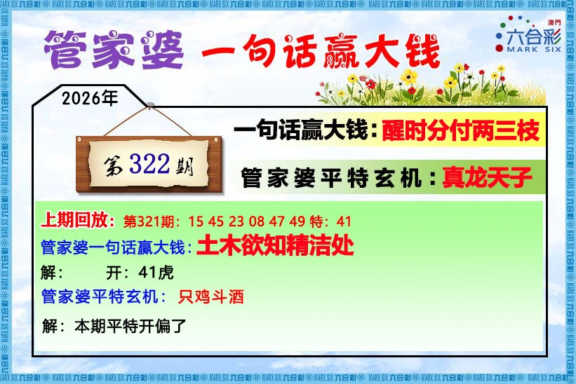
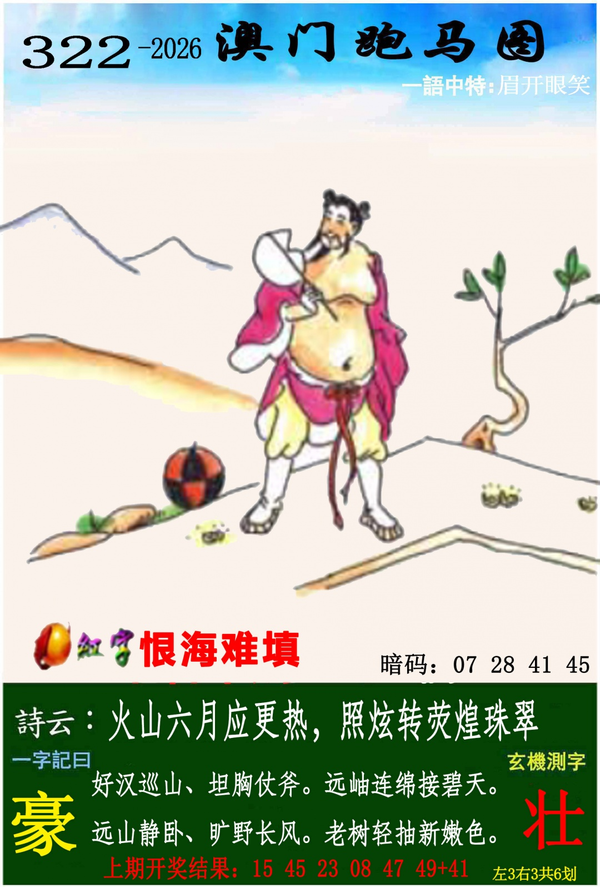
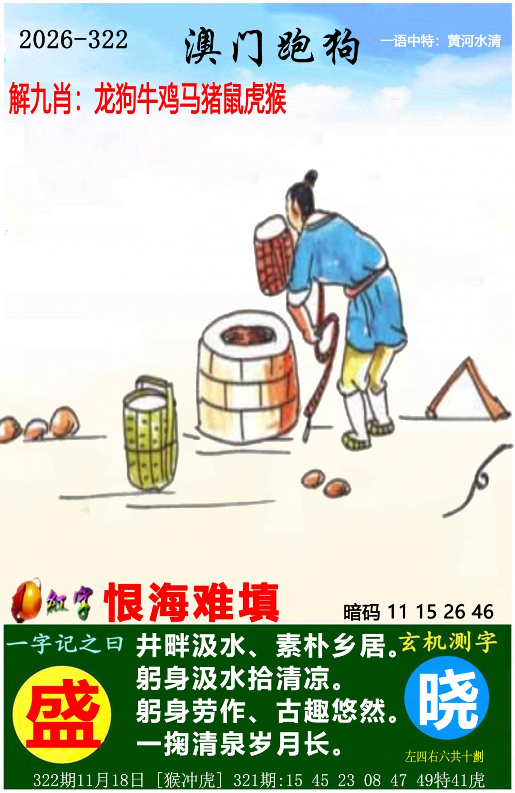
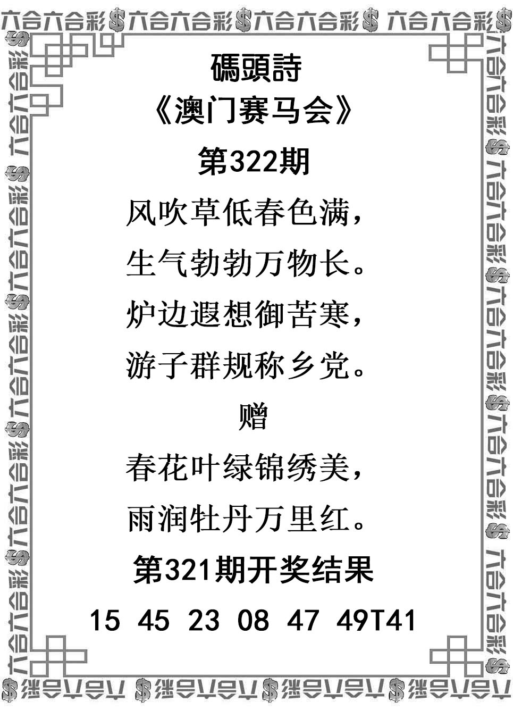
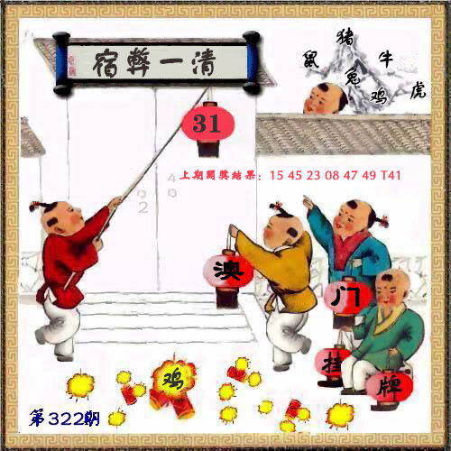

# 2026年第322期

首47猴，特07鼠。原主6与防3均未覆盖。07已作为单七同号列过，未锁定。

- [当期开奖](开奖结果.md)、[结构化结果](开奖结果.json)和[来源核验](开奖来源/核验记录.json)。
- [完整复盘](复盘.md)、[58项审计](复盘证据审计.csv)及[开奖前版本核验](开奖前版本核验.json)。
- 原主6依次为马、猴、牛、羊、蛇、兔，原防3依次为猪、鸡、虎。[原分析](分析-v001.md) · [逐肖总结](总结-v001.md) · [原冻结凭据](冻结记录/v001/凭据.json)
- [资料说明](资料说明.md)、[检查](资料检查.json)、[原证据](证据表.csv)、[预测及评价](预测记录.json)和[时间记录](时间记录.jsonl)。

## 六张原图

### 01-管家婆

SHA256：21975b78922415f549339bc52bd694ff20f6cb1f990418618f732189e90149b8

### 02-跑马

SHA256：b7550007b37e1958a33e68134bbce9b68d36037669e46d61ed8cc56eca9eaa8d

### 03-跑狗

SHA256：51018f7281a6c4c155e9e6969be1468948715766c2191bfba62502f5283af41d

### 04-码头诗

SHA256：d306925f7fe097b4f73fa5f58b11f093d0221ab37ee689701a06a85b80b66cd0

### 05-澳门传真

SHA256：fc4e5c4eeb3d2757cb61bcee5911842587783a73e48cd3b173fbf0d09d7c2caa

### 06-澳门挂牌

SHA256：0c2970676ff6e4881192cfdebba98d152522cb28e83ed8e6f06a803bc07ca455
